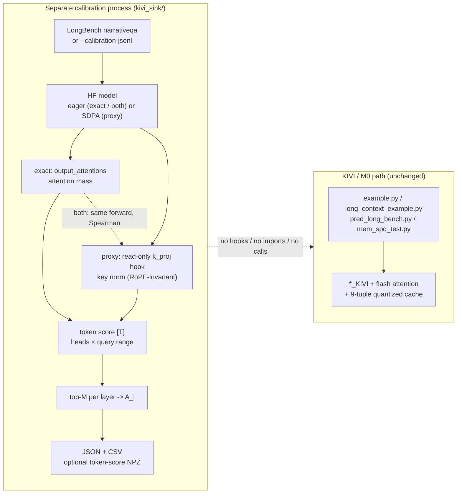

# SinkBudget

**Layer-wise sink protection budgeting and decode-time delayed quantization for KV cache quantization.**

English | [简体中文](README.zh-CN.md)

> **Project status (2026-11-22):** SinkBudget is a research fork of [KIVI](https://github.com/jy-yuan/KIVI). The upstream KIVI baseline is runnable today; the sink-aware research modules are **not implemented yet**. Milestone **M0** is in progress: the **Llama-first (L1)** strategy is confirmed, the Llama model configs and the baseline recorder are in place, and the static check passes. GPU-dependent smoke tests and baseline repeats still need to run on an NVIDIA GPU. See the [roadmap](docs/kv_cache_sink_protection_roadmap.md) and the [M0 baseline record](docs/m0_llama_baseline.md).

## Overview

KIVI quantizes the key cache per channel and the value cache per token to 2/4 bits, while keeping the most recent `residual_length` tokens in full precision. SinkBudget keeps that quantizer fixed and asks a different question:

> Given a fixed FP-byte budget, **which tokens should bypass quantization**, and **when should a newly generated token be quantized?**

The project studies two mechanisms:

1. **Layer-wise heterogeneous sink protection.** A light offline calibration estimates how much attention mass each layer concentrates on a few sink tokens. The budget is then allocated across layers, instead of protecting the same number of tokens everywhere.
2. **Decode-time delayed quantization.** Newly generated tokens first stay in an FP observation window. When a token slides out, it is kept in FP only if its accumulated attention score is high and a dynamic slot is available; otherwise it is quantized once, irreversibly.

The intended cache layout is a token-level hybrid: **FP protected pool + KIVI quantized pool + recent FP window**, with segmented attention combined through online softmax.

## Research questions

1. Under the same effective FP-byte budget, does layer-wise sink-dependency allocation outperform uniform, random, reverse, attention-only, and quant-error-only allocation?
2. Is decode-time delayed quantization necessary beyond KIVI's recent FP window, especially on long-output tasks?

## Method at a glance

| Stage | What happens | Output |
|---|---|---|
| Offline calibration | Estimate per-layer sink mass `A_l` (average top-`M` attention mass), optionally combine with normalized KIVI reconstruction error `E_l`; `L_l = A_l (1 + λ E_l)` | Per-layer budget `P_l = S_l + D_l` |
| Online prefill | Recompute token scores on the current sequence; protect the top `S_l` tokens, with position 0 always protected | FP protected token set per layer |
| Decode | Accumulate attention scores for new tokens; when a token leaves the observation window, keep it FP or quantize it once | Dynamic FP slots, one-way FP → low-bit |
| Cache | FP protected pool + KIVI quantized pool + recent FP window | Segmented attention with online softmax merge |

Design constraints:

- Protected tokens keep **both K and V** in FP; all other tokens follow the original KIVI path.
- Scale-preserving protection is the main setting: protected rows do not change the quantization grid of unprotected tokens. Recalibrated protection is an engineering ablation.
- KIVI's K per-channel / V per-token asymmetry is kept as-is. K-only or V-only protection is diagnostic, not part of the main matrix.

### Claim boundaries

| Implemented stage | Claims allowed |
|---|---|
| Fake-quant prototype | Accuracy change and theoretical FP-byte accounting only; no real memory savings or speedup claims |
| Logical dual-pool cache | Logical memory footprint, prototype overhead, and correctness |
| Segmented kernel | End-to-end latency, peak memory, and tokens/s |

## Roadmap and status

| Stage | Scope | Status |
|---|---|---|
| M0 | Run the original KIVI project end to end; agree on the new test model; freeze baselines | In progress — non-GPU setup done; GPU runs pending |
| M1 | Attention statistics and sink-score prototype | Not started |
| M2 | Fake-quant protection and layer-wise budget allocation | Not started |
| M3 | Main baseline matrix and long-context accuracy experiments | Not started |
| M4 | Decode-time delayed quantization and dynamic-slot simulation | Not started |
| M5 | Logical dual-pool cache and segmented attention | Not started |
| M6 | Efficiency systematization and kernel prototype | Not started |
| M7 | Ablations, paper, and reproducibility package | Not started |

M0.2 is settled: **L1** was confirmed with the user — M1–M5 run on `Llama-3.1-8B-Instruct` with `Llama-2-7b-hf` as the MHA regression model, and Qwen2.5 is deferred to M5.5. M0.1/M0.3 are partially done: the static check passes, the Llama configs and `scripts/m0_baseline.py` are in place, while the CUDA extension, examples, LongBench smoke, and three-repeat baselines await a GPU host. The upstream KIVI implementation remains the executable baseline for now.

## Baseline: what runs today

This repository currently contains the upstream KIVI implementation:

- Models: Llama-2 / Llama-3 family (including GQA) and Mistral / LongChat.
- Quantization: `k_bits` / `v_bits` in {2, 4}, configurable `group_size`, and a recent FP window of `residual_length` tokens.
- Paths: a PyTorch eager attention path and a FlashAttention path. KIVI requires `config.use_flash = True`; the eager Llama path only supports MHA, so GQA models must use the flash path.
- Tokenizers: Llama-3.x uses the fast BPE tokenizer (`tokenizer.json`); Llama-2 / LongChat keep the slow tokenizer. `utils/tokenizer_utils.py` selects the implementation, because Llama-3.x only ships `original/tokenizer.model`, so forcing `use_fast=False` fails with `TypeError: not a string`.
- Kernels: Triton quantization/packing in `quant/new_pack.py` and the fused dequant + GEMV CUDA extension `kivi_gemv` in `quant/`.

For an in-depth walkthrough of the cache state machine, kernel layout, and extension points, see [KIVI 项目结构与代码链路分析](docs/KIVI_项目结构与代码链路分析.md) (Chinese).

## Installation

Requirements: Python ≥ 3.10, an NVIDIA GPU, CUDA toolkit, and the dependencies pinned in `pyproject.toml` (`torch==2.4.1`, `transformers==4.43.1`, `flash-attn`, `modelscope`). `requirements.txt` is a legacy lock file and is not the source of truth.

```bash
# Requires uv: https://docs.astral.sh/uv/getting-started/installation/

# Create and activate a Python 3.10 virtual environment
uv venv --python 3.10
source .venv/bin/activate

# Main package
uv pip install -e .

# Build the KIVI CUDA extension `kivi_gemv` (required by the quantized cache path).
# Needs an NVIDIA GPU, a CUDA toolkit matching the installed torch, and nvcc on PATH.
# `--no-build-isolation` is required: quant/setup.py imports torch, but an
# isolated build env only contains setuptools, so without this flag the build
# fails with `ModuleNotFoundError: No module named 'torch'`.
# Re-run this after changing anything under quant/csrc/.
cd quant
uv pip install -e . --no-build-isolation
cd ..
```

Models are fetched from **ModelScope by default**. Pass `--model_source hf` (or `model_source="hf"` when calling `utils.modelscope_hub.resolve_model_path`) to load from Hugging Face Hub instead; model ids must be valid on the selected source.

**Downloads default to `~/data`** for both sources (override with the `KIVI_DATA_DIR` environment variable; an explicit `--cache_dir` still takes precedence):

```text
~/data/
├── modelscope/   # ModelScope model snapshots
├── hf/
│   ├── hub/      # Hugging Face model snapshots
│   └── datasets/ # Hugging Face datasets cache
└── datasets/
    ├── longbench/
    └── gsm8k/
```

Benchmark data follows the same rule (`--data_source hf` opts into Hugging Face; leaving it unset means "follow `--model_source`"). **Every loader checks the machine before downloading**, in this order:

1. an explicit directory: `--data_dir`, or `LONGBENCH_DATA_DIR` / `GSM8K_DATA_DIR`, holding `data/*.jsonl` or `data.zip`;
2. an already-extracted copy under the cache dir (`--cache_dir`, default `~/data/datasets`): `<cache_dir>/longbench/data/`, `<cache_dir>/gsm8k/`;
3. an existing ModelScope or Hugging Face snapshot on the machine (for example `~/data/modelscope/hub/datasets/ZhipuAI/LongBench` or `~/.cache/modelscope/hub/datasets/ZhipuAI/LongBench`).

Only when none of these exist does it download: LongBench's `data.zip` (~114 MB) from the ModelScope dataset `ZhipuAI/LongBench`, and the GSM8K split jsonl files declared by `modelscope/gsm8k`. `scripts/long_test.sh` passes `--cache_dir ./cached_models`, so extracted data lands there. Nothing is fetched from `huggingface.co` on the default path; the same local-first check applies to model weights (`--cache_dir`, `cached_models/`, the ModelScope/HF caches, `~/data`), so a second run never re-downloads.

## Quick start

### Load a KIVI baseline model

```python
import torch
from models.llama_kivi import LlamaForCausalLM_KIVI
from transformers import LlamaConfig, AutoTokenizer
from utils.modelscope_hub import resolve_model_path

# ModelScope id by default; use model_source="hf" for a Hugging Face id.
model_path = resolve_model_path(
    "LLM-Research/Meta-Llama-3.1-8B-Instruct",
    model_source="modelscope",
)

config = LlamaConfig.from_pretrained(model_path)
config.k_bits = 2              # 2 or 4
config.v_bits = 2              # 2 or 4
config.group_size = 32
config.residual_length = 128   # number of recent FP tokens
config.use_flash = True        # required by KIVI

model = LlamaForCausalLM_KIVI.from_pretrained(
    model_path,
    config=config,
    torch_dtype=torch.float16,
    low_cpu_mem_usage=True,
    device_map="auto",  # or {"": "cuda:1"} to pin the model to one GPU
)
tokenizer = AutoTokenizer.from_pretrained(model_path)

output = model.generate(**tokenizer("Hello", return_tensors="pt").to(model.device),
                        max_new_tokens=32)
```

For Mistral, import `MistralForCausalLM_KIVI` from `models.mistral_kivi` and use `MistralConfig`. Quantization parameters must be set on the config **before** loading the model.

| Parameter | Meaning | Typical values |
|---|---|---|
| `k_bits` / `v_bits` | K/V cache bit width | 2, 4 |
| `group_size` | Quantization group size | 32, 64, 128 |
| `residual_length` | Number of recent FP tokens | 32, 128 |
| `use_flash` | Use the FlashAttention path | `True` (required) |

### Examples

```bash
python example.py              # GSM8K 5-shot with Llama-3.1-8B-Instruct
python long_context_example.py # passkey retrieval
python mem_spd_test.py         # latency and peak memory

# All three accept --model_name_or_path / --cache_dir / --model_source (default: modelscope)
# and --device to pick a GPU (PyTorch-visible index: --device cuda:1 or --device 1)
python example.py --model_source hf --model_name_or_path meta-llama/Llama-3.1-8B-Instruct --device cuda:1
```

### LongBench

```bash
bash scripts/long_test.sh 0 2 2 32 128 modelscope/Llama-2-7b-ms
python eval_long_bench.py --model Llama-2-7b-ms_4096_2bits_group32_residual128
```

`scripts/long_test.sh` takes `{GPU_ID} {K_BITS} {V_BITS} {GROUP_SIZE} {RESIDUAL_LENGTH} {MODEL} [MODEL_SOURCE] [DATA_DIR]`. `MODEL_SOURCE` defaults to `modelscope` (the Llama-2 base model is published as `modelscope/Llama-2-7b-ms`); pass `hf` to use a Hugging Face id such as `meta-llama/Llama-2-7b-hf`. The optional `DATA_DIR` is forwarded as `--data_dir`. Predictions are written under `pred/`, and `eval_long_bench.py` scores them. Dataset and prompt settings live in `config/`.

`pred_long_bench.py` also accepts `--device` (same visible-index semantics as the example scripts), e.g. `--device 1`; `scripts/long_test.sh` keeps using its first `GPU_ID` argument.

Interrupted runs can be resumed: pass `--resume` to `pred_long_bench.py`, or set `RESUME=1` for `scripts/long_test.sh`. Completed tasks and samples are skipped, and an incomplete trailing JSONL line is truncated to the last complete record. Each prediction directory gets a `run_meta.json`; `--resume` refuses to continue if the model, quantization, max length, prompt or generation-length config changed. Do not combine `--resume` with `m0_baseline.py --repeat > 1` — later repeats would see the completed predictions and skip them.

`config/model2maxlen.json` caps Llama-3.1-8B / Meta-Llama-3.1-8B prompts at **4096** tokens so the 8B LongBench runs fit on a 24GB RTX 3090; raise the entry only when the GPU can hold the prefill logits.

LongBench data is downloaded once from ModelScope and extracted under `./cached_models/longbench/`. To reuse data that is already on the machine (for example a copy synced from another host), point the loader at it instead:

```bash
python pred_long_bench.py --model_name_or_path modelscope/Llama-2-7b-ms \
    --cache_dir ./cached_models --data_dir /path/to/longbench \
    --k_bits 2 --v_bits 2 --group_size 32 --residual_length 128 --device 1
```

`--data_dir` may hold `data/*.jsonl`, `data.zip`, or `{task}.jsonl` directly; nothing is downloaded when the requested task file is found. Add `--data_source hf` only if you deliberately want the Hugging Face `THUDM/LongBench` copy (this needs HF network access).

### M0 baseline records

The M0 scaffolding is in place. GPU-dependent runs still need to be executed on a machine with an NVIDIA GPU:

```bash
# Validate the frozen KIVI config without a GPU
python scripts/m0_baseline.py check \
    --k-bits 2 --v-bits 2 --group-size 32 --residual-length 128

# Record GPU/CUDA/PyTorch/Transformers/git metadata
python scripts/m0_baseline.py env --out results/m0_baselines/env.json

# Repeat a baseline three times; successes and failures are both persisted
python scripts/m0_baseline.py run --name llama2_kivi2_longbench --repeat 3 -- \
    bash scripts/long_test.sh 0 2 2 32 128 modelscope/Llama-2-7b-ms
```

Raw records land in `results/m0_baselines/` (git-ignored). The curated status, fixed KIVI configuration, L1 model-selection record, and the GPU TODO list live in the [M0 Llama baseline record](docs/m0_llama_baseline.md) (Chinese).

### M1 sink calibration (prototype)

M1 adds `kivi_sink/` (read-only attention statistics / sink scores) and `tests/`. It does not touch the KIVI inference path: calibration loads a separate Hugging Face model in its own process, and the `.npz` / JSON artifacts stay outside the model checkpoint.



```bash
# Pure-function smoke test, no model or dataset needed (random Q/K tensors)
python -m kivi_sink.calibration --synthetic --mode both \
    --samples 3 --synthetic-layers 4 --max-length 64 --top-m 2 \
    --output results/sink/calibration/synthetic.json

# Exact attention on a short diagnostic window (eager attention; memory is O(heads * T^2))
python -m kivi_sink.calibration \
    --model LLM-Research/Meta-Llama-3.1-8B-Instruct \
    --mode exact --max-length 512 --samples 8 \
    --output results/sink/calibration/llama31_exact.json

# Exact + key-norm proxy in one eager pass, with a Spearman correlation report
python -m kivi_sink.calibration \
    --model LLM-Research/Meta-Llama-3.1-8B-Instruct \
    --mode both --max-length 512 --samples 8 \
    --output results/sink/calibration/llama31_both.json

# Long-context proxy pass (no attention matrix; read-only k_proj hooks)
python -m kivi_sink.calibration \
    --model LLM-Research/Meta-Llama-3.1-8B-Instruct \
    --mode proxy --max-length 4096 --samples 16 \
    --output results/sink/calibration/llama31_proxy.json \
    --save-token-scores results/sink/calibration/llama31_proxy.npz

# Evaluate M1 metrics (A_l heterogeneity, stability, proxy correlation, CI width)
# and print pass/warn checks; works on any calibration JSON
python -m kivi_sink.report \
    --input results/sink/calibration/llama31_both.json \
    --min-samples 8 \
    --json-out results/sink/calibration/llama31_both.report.json

# Unit tests (CPU only)
python -m unittest discover -s tests -v
```

Calibration defaults to LongBench `narrativeqa`, which is outside both evaluation task lists; `--calibration-jsonl` accepts a separate held-out set, and evaluation tasks are rejected unless `--allow-eval-task` is passed deliberately. Each run writes a JSON summary plus a sibling CSV (per-layer `A_l` statistics and exact-vs-proxy Spearman). `python -m kivi_sink.report` turns that JSON into M1 metrics — `A_l` heterogeneity vs the uniform `top_m/T` reference, cross-sample stability, proxy validity, bootstrap CI width — and prints provisional pass/warn checks. See the [M1 calibration notes](docs/m1_sink_calibration.md) (Chinese) for the schema, query-fraction semantics, and current GPU TODO list.

## Repository layout

```text
models/        KIVI implementations for Llama and Mistral (*_kivi.py)
quant/         Triton quantization/packing + CUDA extension (kivi_gemv)
utils/         argument parsing and data helpers
config/        model paths, max lengths, and LongBench prompts
scripts/       long_test.sh, m0_baseline.py
kivi_sink/     M1 calibration: attention stats, sink scores, calibration runner
tests/         unit tests for kivi_sink (CPU only)
docs/          research plan, roadmap, code walkthrough, LongBench results
example.py, long_context_example.py, mem_spd_test.py
pred_long_bench.py, eval_long_bench.py, metrics.py
```

## Evaluation plan

Accuracy and efficiency will be compared under identical model, tokenization, generation parameters, KIVI bit configuration, recent FP window `R`, effective FP-byte budget, and context/generation length distributions:

- Layer-score validity: small-scale protection sweeps on representative layers (diagnostic only).
- Prefill sink protection: WikiText / PG19 perplexity, RULER / NIAH, LongBench long-input short-output tasks.
- Decode delayed quantization: GSM8K, MATH, MBPP / HumanEval, and LongBench long-output tasks.
- Proxy validity: rank correlation between exact cumulative attention scores and key-similarity / activation proxies.
- Overhead: calibration cost, per-step score updates, slot decisions, metadata, logical FP/quantized pool memory, effective bits per token, and tokens/s.

## Documentation

- [Research proposal (Chinese)](docs/KV%20Cache量化优化.md) — problem, method, baselines, ablations, risks.
- [Engineering roadmap (Chinese)](docs/kv_cache_sink_protection_roadmap.md) — M0–M7 tasks, deliverables, acceptance criteria, and verification commands.
- [M0 Llama baseline record (Chinese)](docs/m0_llama_baseline.md) — L1 selection, fixed KIVI config, environment template, GPU TODO list.
- [M1 calibration notes (Chinese)](docs/m1_sink_calibration.md) — attention stats, sink scores, calibration commands, output schema, GPU TODO list.
- [Code walkthrough (Chinese)](docs/KIVI_项目结构与代码链路分析.md) — cache state machine, kernel layout, and extension points.
- [LongBench results](docs/long_bench.md) — upstream KIVI results for LongChat and Mistral.

## Citation

SinkBudget builds on KIVI. If you use the baseline implementation, please cite:

```bibtex
@article{liu2024kivi,
  title={KIVI: A Tuning-Free Asymmetric 2bit Quantization for KV Cache},
  author={Liu, Zirui and Yuan, Jiayi and Jin, Hongye and Zhong, Shaochen and Xu, Zhaozhuo and Braverman, Vladimir and Chen, Beidi and Hu, Xia},
  journal={arXiv preprint arXiv:2402.02750},
  year={2024}
}
```

## License

MIT. See [LICENSE](LICENSE). Upstream KIVI is also released under the MIT License.
