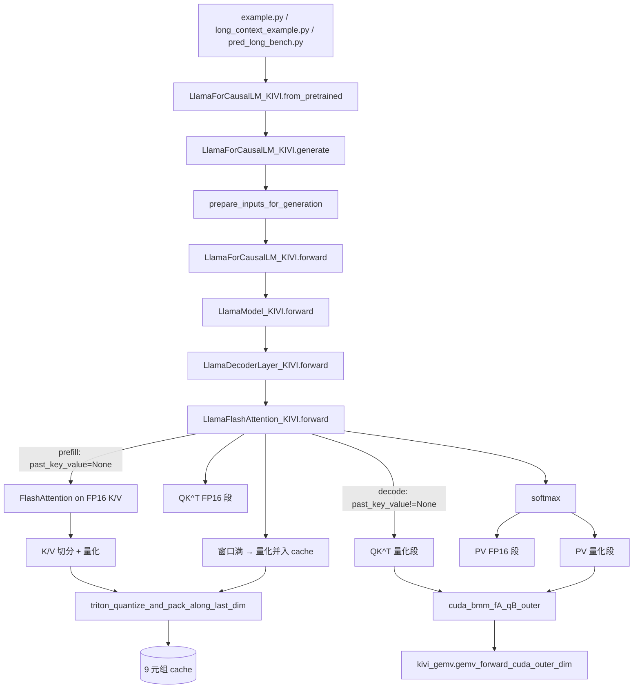

# KIVI 项目结构与代码链路分析

> 分析对象：当前 `main` 分支（基线提交 `876b4d2`）。
>
> 分析范围：仓库实际代码，不包含论文本身的实验结论。文中“当前实现”均指本仓库 `models/` 与 `quant/` 下的代码。
>
> 目标读者：需要在 KIVI 上做二次开发（改量化策略、加缓存保护、换 kernel、接新模型）的工程/研究人员。

---

## 0. 结论速览

- KIVI 是一个 **plug-and-play 的 KV Cache 训练后量化（PTQ）** 实现：模型权重不量化，只把推理过程中缓存的 Key/Value 量化到 2/4 bit。
- 量化格式是 **分组非对称 min-max 均匀量化**：
  - **Key 按 channel 量化**（沿 token 维分组）；
  - **Value 按 token 量化**（沿 head_dim 分组）；
  - 最近 `residual_length` 个 token 保持 FP16，不量化。
- 工程实现分两条路径：
  - **写路径（量化 + 打包）**：PyTorch 做 scale/zero 计算，Triton kernel 做分组 min/max 与 bit packing；
  - **读路径（反量化 + 矩阵乘）**：自定义 CUDA 扩展 `kivi_gemv` 把“解包 → 反量化 → GEMV”融合成一个 kernel，直接对压缩缓存做 attention。
- 模型侧通过**替换 HuggingFace 的 Attention / DecoderLayer / Model / CausalLM 四个层级**接入，缓存结构是一个 9 元组，而不是标准 `(key, value)`。
- 当前仓库实际使用的量化入口只有 [quant/new_pack.py](../quant/new_pack.py) 的 `triton_quantize_and_pack_along_last_dim` 和 [quant/matmul.py](../quant/matmul.py) 的 `cuda_bmm_fA_qB_outer`；`quant/qmodule.py`、`models/utils_quant.py` 等属于未接入主链路的遗留/实验代码。

---

## 1. 仓库结构

```text
KIVI/
├── models/                          # 模型侧：用 KIVI 版本替换 HF 的 Llama / Mistral 组件
│   ├── llama_kivi.py                # Llama 全链路（Attention / FlashAttention / Layer / Model / CausalLM）
│   ├── mistral_kivi.py              # Mistral 全链路（含 GQA repeat_kv 与 sliding-window 相关代码）
│   ├── utils_quant.py               # 量化工具/实验代码（含 dequant_cuda 引用），未接入主链路
│   └── __init__.py
├── quant/                           # 量化算法 + CUDA/Triton kernel
│   ├── new_pack.py                  # 核心：分组 min-max 量化、bit packing（Triton 实现）
│   ├── matmul.py                    # 核心：量化 KV 的 BMM 调度（Triton 参考实现 + CUDA 调用）
│   ├── csrc/
│   │   ├── gemv_cuda.cu             # CUDA 融合 kernel：解包、反量化、GEMV
│   │   ├── gemv_cuda.h              # C++ 接口声明
│   │   ├── pybind.cpp               # pybind11 模块入口
│   │   └── gemv_cuda_backup.cu      # 旧版本备份
│   ├── setup.py                     # 编译 kivi_gemv CUDA 扩展
│   ├── qmodule.py                   # 4-bit weight 量化实验代码（依赖未随仓库提供的 dequant_cuda/pack）
│   ├── test.py / gemv.py / timeit_v2.py  # kernel 正确性/性能测试脚本
│   └── __init__.py
├── config/                          # LongBench 的模型路径、最大长度、prompt 模板
├── utils/                           # 参数解析、数据加载、评测指标
├── scripts/long_test.sh             # LongBench 预测启动脚本
├── example.py                       # GSM8K few-shot 示例
├── long_context_example.py          # Passkey retrieval 示例
├── mem_spd_test.py                  # 峰值显存 / 吞吐测试
├── pred_long_bench.py               # LongBench 推理入口
├── eval_long_bench.py               # LongBench 打分入口
├── metrics.py                       # LongBench 指标实现
├── passkey_examples.jsonl           # Passkey 样例数据
├── pyproject.toml                   # 根包 kivi 的安装配置
├── requirements.txt                 # 完整环境快照（与 pyproject 的版本并不完全一致）
└── docs/                            # 文档
```

### 1.1 文件职责速查

| 层次 | 文件 | 职责 | 是否在主推理链路 |
| --- | --- | --- | --- |
| 入口 | [example.py](../example.py) | 加载 Llama-3.1-8B + GSM8K prompt，演示 2bit KIVI 生成 | 是（示例） |
| 入口 | [long_context_example.py](../long_context_example.py) | 逐条跑 `passkey_examples.jsonl`，演示长上下文 | 是（示例） |
| 入口 | [mem_spd_test.py](../mem_spd_test.py) | 固定 batch/长度，测 generate 时间与 `max_memory_allocated` | 是（基准） |
| 入口 | [pred_long_bench.py](../pred_long_bench.py) | 选择 Llama/Mistral，按 LongBench 任务批量生成预测 | 是（评测） |
| 入口 | [eval_long_bench.py](../eval_long_bench.py) | 读取 `pred/` 下 jsonl，调用 [metrics.py](../metrics.py) 打分 | 是（评测） |
| 模型 | [models/llama_kivi.py](../models/llama_kivi.py) | Llama 版 KIVI 全链路 | **是** |
| 模型 | [models/mistral_kivi.py](../models/mistral_kivi.py) | Mistral 版 KIVI 全链路（GQA + sliding window） | **是** |
| 算法 | [quant/new_pack.py](../quant/new_pack.py) | 量化、打包、解包、Triton kernel | **是** |
| 算法 | [quant/matmul.py](../quant/matmul.py) | 量化矩阵乘调度；Triton 参考 kernel；CUDA 入口 | **是** |
| Kernel | [quant/csrc/gemv_cuda.cu](../quant/csrc/gemv_cuda.cu) | 融合 GEMV（2/4 bit） | **是** |
| 构建 | [quant/setup.py](../quant/setup.py) | 编译 `kivi_gemv` | 安装期 |
| 遗留 | [models/utils_quant.py](../models/utils_quant.py) | 分组量化/fake-quant 实验函数，引用未提供的 `dequant_cuda` | 否 |
| 遗留 | [quant/qmodule.py](../quant/qmodule.py) | 4-bit 权重量化实验，依赖未提供的 `dequant_cuda`/`pack` | 否 |
| 测试 | [quant/test.py](../quant/test.py) | 量化/反量化误差、BMM 正确性 | 否 |

> 注意：`quant/gemv.py` 在 import 时设置 `CUDA_VISIBLE_DEVICES="2"`，属于开发脚本，不应被主程序导入。

---

## 2. 总体架构

### 2.1 分层视图

```text
┌──────────────────────────────────────────────────────────────────┐
│ 应用/评测层                                                       │
│ example.py · long_context_example.py · mem_spd_test.py            │
│ pred_long_bench.py → eval_long_bench.py → metrics.py              │
└───────────────────────────────┬──────────────────────────────────┘
                                │ 设置 config.k_bits / v_bits /
                                │ group_size / residual_length / use_flash
┌───────────────────────────────▼──────────────────────────────────┐
│ 模型层 models/llama_kivi.py · models/mistral_kivi.py              │
│  · LlamaForCausalLM_KIVI / MistralForCausalLM_KIVI                │
│  · *Model_KIVI → *DecoderLayer_KIVI → *FlashAttention_KIVI        │
│  · 负责：attention 计算、residual window 维护、9 元组缓存管理       │
└───────────────┬───────────────────────────────┬──────────────────┘
                │ 写入：量化 + 打包              │ 读取：反量化 + BMM
┌───────────────▼────────────────┐  ┌───────────▼──────────────────┐
│ 算法层 quant/new_pack.py        │  │ 算法层 quant/matmul.py        │
│ · min/max、scale/zero、clamp    │  │ · cuda_bmm_fA_qB_outer        │
│ · Triton _minmax_along_last_dim │  │ · triton_bmm_fA_qB_outer（参考）│
│ · Triton _pack_along_last_dim   │  │                              │
└───────────────┬────────────────┘  └───────────┬──────────────────┘
                │                               │
┌───────────────▼────────────────┐  ┌───────────▼──────────────────┐
│ Triton 写 kernel               │  │ CUDA 读 kernel kivi_gemv      │
│ （即时编译，随 PyTorch 运行）   │  │ · bgemv2_kernel_outer_dim     │
│                                │  │ · bgemv4_kernel_outer_dim     │
└────────────────────────────────┘  └──────────────────────────────┘
```

### 2.2 三个关键设计决策

1. **只量化 KV Cache，不量化权重。**
   所有 `q_proj/k_proj/v_proj/o_proj/mlp` 仍是 FP16；量化只发生在写缓存与读缓存时。
2. **K 与 V 使用不同的分组维度。**
   这是 KIVI 的核心：Key 的通道维存在稳定的 outlier，按 channel 分组量化；Value 的 token 内分布更均匀，按 token 分组量化。
3. **最近 token 保留 FP16。**
   通过 `residual_length` 维护一个“滑动 FP 窗口”，既降低量化误差，也让新 token 的 K 能凑满一个分组后再量化。

---

## 3. 量化器架构

### 3.1 量化数学

对任意分组内的张量 `x`，采用非对称 min-max 均匀量化：

```text
mx    = max(x)                     # 分组内最大值
mn    = min(x)                     # 分组内最小值（即 zero point）
scale = (mx - mn) / (2^bits - 1)
q     = clamp(round((x - mn) / scale), 0, 2^bits - 1)
x_hat = q * scale + mn             # 反量化
```

- `bits ∈ {2, 4}`（打包函数也支持 8，但模型主路径断言 2/4）。
- `scale`、`mn` 以 FP16 存储；`q` 以 int32 位打包存储。
- 非对称的好处：不需要假设数据零均值，能覆盖 KV 中的负值；实现上只需 scale + zero，无需额外符号位。

### 3.2 K / V 的分组方式

| 缓存 | 张量形状（进入量化函数） | 分组维度 | scale/mn 形状 | 语义 |
| --- | --- | --- | --- | --- |
| Key | `[B, H_kv, D, T]`（先 `transpose(2,3)`） | 沿 **T**，每组 `group_size` 个 token | `[B, H_kv, D, T/group_size]` | 每个 `(b, head, channel)` 在 token 维上共享一组 scale/zero → **per-channel** |
| Value | `[B, H_kv, T, D]` | 沿 **D**，每组 `group_size` 个通道 | `[B, H_kv, T, D/group_size]` | 每个 `(b, head, token)` 在 head_dim 内共享一组 scale/zero → **per-token** |

其中 `D = head_dim`，`H_kv = num_key_value_heads`。

直觉解释：

- Key 经过 RoPE 后，某些通道的数值尺度在不同 token 上相对稳定，而不同通道之间差异大。按 channel 分组（即“对同一通道的一组 token 求 min/max”）可以隔离通道间的尺度差异。
- Value 没有这种稳定的通道 outlier，单个 token 内的元素分布更接近，按 token 分组（“对同一 token 的一组通道求 min/max”）更自然。
- 两边的分组都沿**最后一维**，因此可以复用同一个 `triton_quantize_and_pack_along_last_dim`。Key 在调用前先转置成 `[B,H,D,T]`，这就是代码里 `key_states_quant_trans` 中 `trans` 的来源。

调用示例（[models/llama_kivi.py:204](../models/llama_kivi.py#L204)、[models/llama_kivi.py:218](../models/llama_kivi.py#L218)）：

```python
# Key：先转置，使 token 维在最后
key_code, key_scale, key_mn = triton_quantize_and_pack_along_last_dim(
    key_states_quant.transpose(2, 3).contiguous(),   # [B,H,D,T]
    self.group_size, self.k_bits,
)

# Value：token 维本来就在倒数第二，直接按最后一维 D 分组
value_code, value_scale, value_mn = triton_quantize_and_pack_along_last_dim(
    value_states_quant,                              # [B,H,T,D]
    self.group_size, self.v_bits,
)
```

### 3.3 打包格式

设 `bits` 为量化位宽，`feat_per_int = 32 // bits`：

| bits | 每个 int32 打包的元素数 |
| ---: | ---: |
| 2 | 16 |
| 4 | 8 |
| 8 | 4 |

打包采用 **小端序（little-endian）**：第 `i` 个元素放在 int32 的第 `i * bits` 位。

```text
int32 word:  [ e0 ][ e1 ][ e2 ] ... [ e15 ]      (2-bit，共 32 bit)
bit offset:    0-1    2-3    4-5         30-31
```

- 写打包：[quant/new_pack.py:132](../quant/new_pack.py#L132) 的 `_pack_along_last_dim`，对每个 output word 做 `packed |= element << (i * bits)`。
- 读解包：[quant/csrc/gemv_cuda.cu:410](../quant/csrc/gemv_cuda.cu#L410) 风格的 `(word >> shift) & mask`，mask 为 `0xFF >> (8 - bits)`。
- PyTorch 参考实现：[quant/new_pack.py:86](../quant/new_pack.py#L86) `pack_tensor`、[quant/new_pack.py:110](../quant/new_pack.py#L110) `unpack_tensor`，主要用于测试和形状核对。

打包后的形状变化：

```text
K: code  [B, H_kv, D,   Tq/p]  int32      scale/mn [B, H_kv, D,   Tq/g]  fp16
V: code  [B, H_kv, TVq, D/p]   int32      scale/mn [B, H_kv, TVq, D/g]   fp16
```

注意打包始终作用在**最后一维**：K 的最后一维是 `T`（token 维），V 的最后一维是 `D`（head_dim）。这与 3.2 节的分组维度一一对应。

其中 `p = 32/bits`，`g = group_size`，`TVq` 是已量化的 Value token 数。

### 3.4 写路径：量化 + 打包的实现链路

入口函数：[quant/new_pack.py:217](../quant/new_pack.py#L217) `triton_quantize_and_pack_along_last_dim(data, group_size, bit)`。

执行步骤：

1. **形状重排**：`data` 形状为 `[B, nh, A, Gdim]`，其中最后一维 `Gdim` 是参与分组的维度（K 为 `T`，V 为 `D`）；重排为 `[B*nh*A, num_groups, group_size]`。
2. **分组 min/max**：调用 Triton kernel `_minmax_along_last_dim`（[quant/new_pack.py:158](../quant/new_pack.py#L158)）。
   - grid 以 `BLOCK_SIZE_N = 128` 覆盖 `B*nh*D*num_groups` 个分组；
   - 每个 program 处理 128 个分组，每组 `group_size` 个元素，沿组内做 `tl.max/tl.min`；
   - 输出 `mn`、`mx`，形状 `[B*nh*D, num_groups]`。
3. **计算 scale**：`scale = (mx - mn) / (2^bit - 1)`。
4. **量化**：`data = clamp(round((data - mn) / scale), 0, 2^bit - 1)`，转 int32。
5. **打包**：调用 Triton kernel `_pack_along_last_dim`（[quant/new_pack.py:132](../quant/new_pack.py#L132)）。
   - grid 为 `(rows / 128, T / feat_per_int)`；
   - 每个 program 负责 128 行、一个 int32 word 位置；
   - 循环 `feat_per_int` 次，读取对应元素、左移、按位或。
6. **返回**：
   - `code`：最后一维从 `Gdim` 变为 `Gdim/p`，即 K 为 `[B, nh, D, T/p]`，V 为 `[B, nh, T, D/p]`；
   - `scale` / `mn`：最后一维变为 `Gdim/g`。

> 注意：第 2 步之前没有做 `mx == mn` 的保护。如果某个分组所有值相同，`scale = 0`，后续 `data / scale` 会产生 inf/nan。正常 KV 数据很少触发，但做鲁棒性改造时需要补一个 `scale.clamp_min(eps)`。

### 3.5 读路径：融合“解包 + 反量化 + GEMV”

模型 decode 阶段需要频繁做两类矩阵乘：

```text
QK^T:  [B,H,1,D]  ×  [B,H,D,Tq]      -> [B,H,1,Tq]
PV:    [B,H,1,Tq] ×  [B,H,Tq,D]      -> [B,H,1,D]
```

KIVI 不先反量化成 FP16 再 `torch.matmul`，而是调用：

[quant/matmul.py:178](../quant/matmul.py#L178)

```python
cuda_bmm_fA_qB_outer(group_size, fA, qB, scales, zeros, bits)
# fA: [B, nh, M, K] FP16        激活（query 或 attention 概率）
# qB: [B, nh_kv, K, N/p] int32  打包后的 KV
# scales/zeros: [B, nh_kv, K, N/g] FP16
# 返回: [B, nh, M, N] FP16
```

内部做三件事：

1. 把 4D 张量 flatten 成 3D；
2. 把 `qB` 从 `[flatten, K, N/p]` 转置为 `[flatten, N/p, K]`，把 `scales/zeros` 从 `[flatten, K, G]` 转置为 `[flatten, G, K]`；
3. 调用 CUDA 扩展 `kivi_gemv.gemv_forward_cuda_outer_dim(...)`（[quant/csrc/gemv_cuda.cu:511](../quant/csrc/gemv_cuda.cu#L511)）。

#### 3.5.1 两种 attention 到 kernel 布局的映射

CUDA kernel 的“outer-dim”布局约定：

```text
weight: [OC/p, IC]   打包后的输出通道 × 输入通道
scale : [OC/g, IC]   按输出通道分组 × 输入通道
input : [BS, IC]
output: [BS, OC]
```

两类乘法的映射如下：

| 乘法 | `IC` | `OC` | `weight`（打包） | `scale/mn` |
| --- | ---: | ---: | --- | --- |
| `Q × K^T` | `D` | `T`（已量化 token 数） | `K_code` → `[T/p, D]` | `K_scale` → `[T/g, D]` |
| `attn × V` | `T` | `D` | `V_code` → `[D/p, T]` | `V_scale` → `[D/g, T]` |

这与 K/V 的分组语义完全一致：

- QK 中 scale 按输出 token 分组、沿输入 channel 展开 → per-channel（同一通道的一组 token 共享 scale）。
- PV 中 scale 按输出 channel 分组、沿输入 token 展开 → per-token（同一 token 的一组 channel 共享 scale）。

#### 3.5.2 CUDA kernel 结构

两个模板 kernel：

| kernel | bits | `pack_factor` | 位置 |
| --- | ---: | ---: | --- |
| `bgemv2_kernel_outer_dim` | 2 | 16 | [quant/csrc/gemv_cuda.cu:348](../quant/csrc/gemv_cuda.cu#L348) |
| `bgemv4_kernel_outer_dim` | 4 | 8 | [quant/csrc/gemv_cuda.cu:265](../quant/csrc/gemv_cuda.cu#L265) |

启动配置：

```text
grid  = (BS, ceil(OC / pack_factor / 4), 1)
block = (32, 4)
```

每个 block 的 4 个 warp 各负责一个打包后的输出通道组；每个 warp 的 32 个线程沿 `IC` 方向并行：

```text
for k in 0 .. ceil(IC / 128):
    每个线程加载 4 个 int32（共 4*pack_factor 个量化权重）
    加载对应的 4 个 scale、4 个 zero、4 个 input
    for each of 4 words:
        for i in 0..pack_factor:
            w = (word & mask); word >>= bits
            w_fp = scale * w + zero
            psum[oc] += w_fp * input
warp_reduce_sum(psum)
thread 0 写回 half
```

关键点：

- 反量化在寄存器里完成，不落地中间 FP16 张量；
- `scale/zero` 按输出通道组索引，因此同一组输出共享一份 scale；
- GQA 通过 `_batch_idx = batch_idx / ratio`（`ratio = nh / nh_kv`）把 query head 映射到 KV head（[quant/csrc/gemv_cuda.cu:361](../quant/csrc/gemv_cuda.cu#L361)），因此 **KV 不需要在显存里物理复制到全部 query head**。

#### 3.5.3 Triton 参考实现

[quant/matmul.py:112](../quant/matmul.py#L112) `triton_bmm_fA_qB_outer` 是同一数学的 Triton 版本，kernel 为 `qbvm_kernel`（[quant/matmul.py:9](../quant/matmul.py#L9)）。主模型路径没有调用它，主要用途是正确性对照和 kernel 原型。注意它的布局与 CUDA 版不同：Triton 版把 scale 按 `N` 维分组，并断言 `group_size % 64 == 0`；CUDA 版则按 `OC` 维分组，对 group_size 的限制是“必须是 `32/bits` 的整数倍”（见 3.9 节）。

### 3.6 residual window（FP16 滑动窗口）状态机

记：

- `r = residual_length`：保留 FP16 的最近 token 数；
- `g = group_size`：量化分组大小；
- `p = 32 / bits`：每个 int32 打包的元素数；
- `Tq`：已量化 token 数；`Tf`：FP16 窗口内 token 数。

#### Prefill 阶段

输入：当前 chunk 的 `T` 个 token（不包含历史，历史已在 cache 中）。

```text
Key:
  若 T % r == 0:      全量量化，Tq = T,   Tf = 0
  否则若 T < r:       全量保留 FP16，Tq = 0, Tf = T
  否则:               前 T - (T % r) 个量化,  Tf = T % r

Value:
  若 T <= r:          全量保留 FP16，Tq = 0, Tf = T
  否则:               前 T - r 个量化,       Tf = r
```

对应代码：[models/llama_kivi.py:424-452](../models/llama_kivi.py#L424-L452)（Llama Flash 路径）。

**一个重要事实**：prefill 阶段的 attention 本身是在 **未量化的当前 K/V** 上通过 FlashAttention 计算的（[models/llama_kivi.py:420](../models/llama_kivi.py#L420)）；量化发生在 attention 计算之后，只影响写入的 cache。也就是说：

> prefill 内部 token 之间的 attention 是 FP16 的；量化误差从 **下一个 decode step** 开始才进入计算。

这解释了为什么 KIVI 在 prefill 很长时仍然能保持较好的精度：误差只累积在 cache 读取路径，而不是 prefill 的 chunk 内。

#### Decode 阶段（每步新增 1 个 token）

```text
1. K 量化前缀参与 QK^T:
     若 K_code 存在 → cuda_bmm_fA_qB_outer(...) 得 [B,H,1,Tq]
2. K FP16 窗口拼接新 K:
     K_full ← concat(K_full, k_new)
3. 全精度 QK^T:
     q @ K_full^T 得 [B,H,1,Tf]
4. concat + /sqrt(D) + mask + softmax → [B,H,1,Tq+Tf]
5. 若 K_full 长度 == r:
     将整个 K_full 转置量化，追加到 K_code/K_scale/K_mn（沿 T 维）
     K_full ← None
6. V FP16 窗口拼接新 V:
     V_full ← concat(V_full, v_new)
7. 输出（Tf_v = V_full 的当前长度）:
     PV = GEMV(attn[:, :, :, :-Tf_v], V_code, V_scale, V_mn)
        + matmul(attn[:, :, :, -Tf_v:], V_full)
8. 若 V_full 长度 > r:
     量化 V_full 中最老的 1 个 token
     追加到 V_code/V_scale/V_mn
     V_full ← V_full[:, :, 1:, :]
```

对应代码：[models/llama_kivi.py:314-399](../models/llama_kivi.py#L314-L399)。

两个窗口的粒度不同，这是由量化维度决定的：

- **K 按 `r` 个 token 成块量化**：per-channel 量化沿 token 维分组，decode 阶段选择在窗口满 `r` 时一次性量化整块，既减少 kernel 调用次数，又让 scale 覆盖足够多的 token；同时 `r` 必须是 `g` 的整数倍以保证分组对齐（代码在量化 K 窗口时有 `assert self.residual_length % self.group_size == 0`）。
- **V 可以每步量化 1 个 token**：per-token 量化沿 head_dim 分组，每个 token 独立成组，滑出窗口即可立即量化。

#### 状态转移表

| 阶段 | K_code | K_full | V_code | V_full |
| --- | --- | --- | --- | --- |
| 初始（无 cache） | `None` | `None` | `None` | `None` |
| Prefill `T <= r` | `None` | `T` 个 token | `None` | `T` 个 token |
| Prefill `T > r` | `T - T%r`（若 `T%r==0` 则全部） | `T%r` 或 `None` | `T - r` | `r` |
| Decode 每步 | 每当 K_full 满 `r` 追加一块 | 增长到 `r` 后清空 | 窗口超 `r` 时追加 1 个 token | 维持 `r` |

### 3.7 缓存数据结构

每层返回一个 **9 元组**（[models/llama_kivi.py:454](../models/llama_kivi.py#L454)）：

```python
past_key_value = (
    key_states_quant_trans,   # [B,H_kv,D,Tq/p]  int32   打包后的 K
    key_states_full,          # [B,H_kv,Tf,D]    fp16    或 None
    key_scale_trans,          # [B,H_kv,D,Tq/g]  fp16
    key_mn_trans,             # [B,H_kv,D,Tq/g]  fp16
    value_states_quant,       # [B,H_kv,TVq,D/p] int32
    value_states_full,        # [B,H_kv,TVf,D]   fp16
    value_scale,              # [B,H_kv,TVq,D/g] fp16
    value_mn,                 # [B,H_kv,TVq,D/g] fp16
    kv_seq_len,               # python int，总序列长度（用于 position/attention mask）
)
```

与 HF 标准 cache（`(key, value)` 两个 FP16 张量）相比：

- 元素个数从 2 变成 9；
- 最后一项是标量 `kv_seq_len`，模型 forward 用它计算 `past_key_values_length`（[models/llama_kivi.py:696-698](../models/llama_kivi.py#L696-L698)）和 `kv_seq_len`（[models/llama_kivi.py:307-309](../models/llama_kivi.py#L307-L309)）；
- `prepare_inputs_for_generation` 也从 `past_key_values[0][-1]` 读取长度（[models/llama_kivi.py:915-917](../models/llama_kivi.py#L915-L917)）；
- `_reorder_cache` 对元组逐元素 `index_select`，但**最后一个标量 `kv_seq_len` 不能 `index_select`**，因此 beam search 路径并不真正可用（当前示例均使用 greedy，不受影响）。

### 3.8 显存占用估算

对单个 KV head、单个 token、2-bit 量化：

```text
K code:  D / p * 4 B  = D/16 * 4 = D/4 B
V code:  D / p * 4 B  = D/4 B
K scale+mn: D/g * 2 * 2 B = 4D/g B
V scale+mn: D/g * 2 * 2 B = 4D/g B
合计: D/2 + 8D/g  B/token
```

对比 FP16 KV：

```text
FP16: 2 * D * 2 = 4D B/token
```

以 `D = 128`、`g = 32` 为例：

| 格式 | 每 token/head | 相对 FP16 |
| --- | ---: | ---: |
| FP16 | 512 B | 1.00× |
| KIVI 2-bit | 96 B | 5.33× |
| KIVI 4-bit | 160 B | 3.20× |

此外每层每 head 还有固定大小的 residual window：

```text
K_full + V_full 峰值 ≈ 2 * r * D * 2 B = 4rD B
```

论文报告的 2.6× 峰值显存收益低于上述理论值，原因包括：权重/激活仍占显存、residual window、cache 拼接产生的临时张量、以及 PyTorch allocator 的碎片。

### 3.9 量化器的不变量与限制

| 约束 | 位置 | 含义 |
| --- | --- | --- |
| `T % group_size == 0` | [quant/new_pack.py:222](../quant/new_pack.py#L222) | 参与量化的 token 数必须是分组大小的整数倍 |
| `D % group_size == 0` | V 量化隐含 | head_dim 必须能被 group_size 整除（如 128 % 32） |
| `residual_length % group_size == 0` | [models/llama_kivi.py:344](../models/llama_kivi.py#L344)、[models/llama_kivi.py:132](../models/llama_kivi.py#L132) | K 窗口量化时保证块对齐 |
| `group_size % (32/bits) == 0` | [quant/csrc/gemv_cuda.cu:273](../quant/csrc/gemv_cuda.cu#L273) | CUDA kernel 以“一个 int32 字”为单位定位 scale 组，分组边界不能落在字内部 |
| `bits ∈ {2,4}` | [quant/matmul.py:215](../quant/matmul.py#L215) | CUDA kernel 只实现 2/4 bit |
| `nh % nh_kv == 0` | [quant/matmul.py:216](../quant/matmul.py#L216) | GQA 映射要求 query head 数是 KV head 数的整数倍 |
| `use_flash=True` | [models/llama_kivi.py:38](../models/llama_kivi.py#L38) | Llama 非 Flash 路径在 `__init__` 中被断言禁用 |

---

## 4. 代码链路

### 4.1 模型加载

以 Llama 为例（[example.py:14-28](../example.py#L14-L28)）：

```python
config = LlamaConfig.from_pretrained("meta-llama/Llama-3.1-8B-Instruct")
config.k_bits = 2
config.v_bits = 2
config.group_size = 32
config.residual_length = 32
config.use_flash = True

model = LlamaForCausalLM_KIVI.from_pretrained(
    "meta-llama/Llama-3.1-8B-Instruct",
    config=config,
    torch_dtype=torch.float16,
    low_cpu_mem_usage=True,
    device_map="auto",
)
```

关键点：

1. `k_bits/v_bits/group_size/residual_length/use_flash` 是**自定义 config 字段**，HF 原生 `LlamaConfig` 不认识，但 Python 对象允许动态加属性；KIVI 的 `__init__` 直接读取。
2. `from_pretrained` 使用 KIVI 的类，但权重名与 HF 一致（`model.layers.*.self_attn.q_proj` 等），因此可以直接加载原始权重。
3. `LlamaDecoderLayer_KIVI.__init__`（[models/llama_kivi.py:564](../models/llama_kivi.py#L564)）根据 `use_flash` 选择 `LlamaAttention_KIVI` 或 `LlamaFlashAttention_KIVI`：
   - 由于 `LlamaAttention_KIVI.__init__` 断言 `use_flash=True`，实际只会走 `LlamaFlashAttention_KIVI`；
   - 非 Flash 分支在当前 Llama 实现中是**不可达代码**。
4. LLM 结构（embedding、MLP、RMSNorm）复用 HF 原生类；只有 attention / decoder layer / model / CausalLM 被替换。

### 4.2 从 `generate()` 到 attention

```text
model.generate(input_ids, ...)
  └─ LlamaForCausalLM_KIVI.prepare_inputs_for_generation   (第 908 行)
       · 若 past_key_values 是 DynamicCache → 转 legacy tuple
       · past_length = past_key_values[0][-1]
       · 只保留最后一个（或若干）新 token 的 input_ids
       · 根据 attention_mask 构造 position_ids
  └─ LlamaForCausalLM_KIVI.forward                         (第 817 行)
       └─ LlamaModel_KIVI.forward                          (第 666 行)
            · inputs_embeds = embed_tokens(input_ids)
            · 构造 attention_mask：
                use_flash 且存在 padding → 2D mask
                use_flash 且无 padding → None
                否则 → 4D causal mask
            · past_key_values_length = past_key_values[0][-1]
            · for layer in self.layers:
                 LlamaDecoderLayer_KIVI.forward                (第 577 行)
                   · input_layernorm
                   · self_attn(...)  → LlamaFlashAttention_KIVI.forward (第 265 行)
                   · residual + MLP + residual
            · self.norm(hidden_states)
       └─ lm_head(hidden_states) → logits
```

`LlamaDecoderLayer_KIVI.forward` 只是标准的 pre-norm 残差结构，不涉及量化；所有量化逻辑都在 attention 的 `forward` 内。

### 4.3 Prefill 链路（`past_key_value is None`）

以 `LlamaFlashAttention_KIVI.forward` 的 else 分支（[models/llama_kivi.py:401](../models/llama_kivi.py#L401)）为例：

```text
1. q/k/v 投影 + reshape:
     q: [B, H, T, D]
     k: [B, H_kv, T, D]
     v: [B, H_kv, T, D]
2. RoPE:
     apply_rotary_pos_emb(q, k, cos, sin, position_ids)
3. FlashAttention:
     attn_output = _flash_attention_forward(
         q.transpose(1,2), k.transpose(1,2), v.transpose(1,2), None, T
     )
     · 使用当前 chunk 的全精度 K/V
     · Llama 版本固定传 None（不处理 padding）
4. K 量化与切分:
     if T % r != 0:
        if T < r:  K 全 FP16
        else:      K_quant = K[:, :, :-(T%r), :]
                   K_full  = K[:, :, -(T%r):, :]
     else:
        K_quant = K；K_full = None
     K_code, K_scale, K_mn = triton_quantize_and_pack_along_last_dim(
         K_quant.transpose(2,3), g, k_bits
     )
5. V 量化与切分:
     if T <= r: V 全 FP16
     else:
        V_quant = V[:, :, :-r, :]
        V_full  = V[:, :, -r:, :]
        V_code, V_scale, V_mn = triton_quantize_and_pack_along_last_dim(
            V_quant, g, v_bits
        )
6. 返回 9 元组 cache
```

从形状角度看 prefill 的输出：

```text
T = 1000, r = 128, g = 32, bits = 2 (p = 16)
K_quant_len = 1000 - (1000 % 128) = 896
K_full_len  = 104
K_code: [B,H_kv,128,896/16] = [B,H_kv,128,56]
K_scale:[B,H_kv,128,896/32] = [B,H_kv,128,28]
V_quant_len = 872
V_full_len  = 128
V_code: [B,H_kv,872,128/16] = [B,H_kv,872,8]
V_scale:[B,H_kv,872,128/32] = [B,H_kv,872,4]
```

### 4.4 Decode 链路（`past_key_value is not None`）

代码：[models/llama_kivi.py:314-399](../models/llama_kivi.py#L314-L399)。

```text
1. 从 9 元组取出 8 个张量 + kv_seq_len
2. QK^T（量化前缀）:
     if K_code is not None:
         att_qkquant = cuda_bmm_fA_qB_outer(
             g, q, K_code, K_scale, K_mn, k_bits
         )   # [B,H,1,Tq]
     else:
         att_qkquant = None
3. QK^T（FP16 窗口）:
     K_full = concat(K_full, k_new)
     att_qkfull = q @ repeat_kv(K_full)^T     # [B,H,1,Tf]
4. 合并:
     attn = concat([att_qkquant, att_qkfull], dim=-1) / sqrt(D)
     attn = attn + attention_mask（若有）
     attn = softmax(attn.float(), dim=-1).half()
5. K 窗口满后量化:
     if K_full.shape[-2] == r:
         K_code_new, K_scale_new, K_mn_new = triton_quantize_and_pack_along_last_dim(
             K_full.transpose(2,3), g, k_bits
         )
         K_code  = concat(K_code,  K_code_new,  dim=3)
         K_scale = concat(K_scale, K_scale_new, dim=3)
         K_mn    = concat(K_mn,    K_mn_new,    dim=3)
         K_full  = None
6. PV:
     V_full = concat(V_full, v_new)
     Tf_v = V_full.shape[-2]
     if V_code is None:
         attn_output = attn @ V_full
     else:
         attn_output  = cuda_bmm_fA_qB_outer(
             g, attn[:, :, :, :-Tf_v], V_code, V_scale, V_mn, v_bits
         )
         attn_output += attn[:, :, :, -Tf_v:] @ repeat_kv(V_full)
7. V 窗口滑动:
     if Tf_v > r:
         quantize V_full[:, :, :1, :] → append 到 V_code/V_scale/V_mn
         V_full = V_full[:, :, 1:, :]
8. 更新 9 元组 cache
```

几个容易忽略的顺序细节：

- **先算 attention，再量化缓冲区**。第 5 步在 `attn` 已经算完之后才把 `K_full` 量化，因此当前 query 仍然看到 FP16 的窗口内容；量化从下一个 decode step 才生效。
- **V 先拼新 token，再判断是否超窗**。`Tf_v > r` 时量化的是窗口里最老的 token（索引 0），然后左移，窗口长度回到 `r`。
- **`attn_output` 的两段拼接点由 V 的窗口长度决定，而不是 K 的 `Tq`**：代码用 `attn[:, :, :, :-value_full_length]` 和 `attn[:, :, :, -value_full_length:]` 切分。K 与 V 的量化前缀长度通常并不相等（K 每 `r` 个 token 量化一次，V 每步滑出 1 个 token），但两者“已量化 + FP16 窗口”的 token 总数都等于 `kv_seq_len`；由于 softmax 已完成，只需对两段分别做加权求和再相加。

### 4.5 输出链路

```text
attn_output: [B, H, 1, D]
  → transpose(1,2).contiguous().reshape(B, 1, H*D)
  → o_proj
  → residual + MLP + residual（decoder layer）
  → self.norm
  → lm_head
  → logits: [B, 1, vocab]
```

### 4.6 LongBench 评测链路

```text
scripts/long_test.sh {GPU} {k_bits} {v_bits} {group_size} {residual_length} {model}
  └─ pred_long_bench.py
       · process_args()（utils/process_args.py）解析 k_bits/v_bits/group_size/
         residual_length/e/cache_dir 等参数
       · 按模型名选择 LlamaConfig/MistralConfig
       · k_bits/v_bits < 16 时加载 KIVI 模型；否则加载原生 HF 模型（作为 FP16 baseline）
       · 从 config/dataset2prompt.json、dataset2maxlen.json 读取任务模板与生成长度
       · 对每个数据集：
           load_dataset("THUDM/LongBench", dataset)
           get_pred(...) → model.generate(...)
           写出 pred/{model}_{maxlen}_{k}bits_group{g}_residual{r}/{dataset}.jsonl
  └─ eval_long_bench.py --model {目录名}
       · 读取 pred/{model}/ 下所有 jsonl
       · 按 dataset2metric 选择 qa_f1/rouge/classification/retrieval/code_sim 等指标
       · 写出 result.json
```

其中 `model2maxlen` 用于截断 prompt（[config/model2maxlen.json](../config/model2maxlen.json)），`dataset2maxlen` 控制 `max_new_tokens`，`dataset2prompt` 是任务模板。

### 4.7 一张图总结调用关系



---

## 5. Llama 与 Mistral 实现的差异

两者结构高度相似，但 Mistral 版本多了对 **GQA** 和 **padding / sliding window** 的处理：

| 差异 | Llama 版 | Mistral 版 |
| --- | --- | --- |
| KV head 重复 | 量化路径由 CUDA kernel 内部 `ratio = nh/nh_kv` 处理；FP16 路径用 `repeat_kv` | 所有路径显式 `repeat_kv` / `repeat_kv_quant` 后再计算 |
| 非 Flash 路径 | `__init__` 断言 `use_flash=True`，实际不可用 | 没有断言，可实例化 `MistralAttention_KIVI` |
| prefill padding | `_flash_attention_forward(..., None, ...)`，忽略 padding mask | 已修复为传入 `attention_mask`（`f138c47`） |
| sliding window | 无 | `_flash_attention_forward` 支持 `use_sliding_windows` 参数，但调用处被注释，当前未启用 |
| RoPE 调用 | `rotary_emb(value_states, position_ids)` | `rotary_emb(value_states, seq_len=...)`，适配旧的 MistralRotaryEmbedding 签名 |
| 4D mask | 无 sliding_window 参数 | `_prepare_4d_causal_attention_mask(..., sliding_window=...)` |
| `pretraining_tp` | 支持 tensor parallel 切片 | 未实现 |

Mistral 的显式 `repeat_kv` 与 CUDA kernel 的 `ratio` 映射在数学上等价，但显式重复会额外占用显存。Llama 的量化路径更节省，但 FP16 分支在 GQA 下存在一个边界问题（见 6.2）。

---

## 6. 当前实现的观察与注意事项

以下内容来自代码阅读，不代表上游作者的已知问题列表；做二次开发时建议先确认。

### 6.1 主链路依赖的两个核心函数

| 方向 | 函数 | 位置 | 备注 |
| --- | --- | --- | --- |
| 写 | `triton_quantize_and_pack_along_last_dim` | [quant/new_pack.py:217](../quant/new_pack.py#L217) | PyTorch + Triton，需要 CUDA |
| 读 | `cuda_bmm_fA_qB_outer` | [quant/matmul.py:178](../quant/matmul.py#L178) | 依赖编译后的 `kivi_gemv` |

安装时必须：

```bash
pip install -e .          # 根包
cd quant && pip install -e .   # 编译 kivi_gemv
```

如果只装根包、不编译 `quant`，`import kivi_gemv` 会失败。

### 6.2 Llama + GQA 的 FP16 Value 分支

在 [models/llama_kivi.py:379-384](../models/llama_kivi.py#L379-L384)：

```python
if value_states_quant is None:
    attn_output = torch.matmul(attn_weights, value_states_full)
```

当 `num_key_value_heads < num_attention_heads`（Llama-3 等 GQA 模型）且 V 尚未量化（序列长度不超过 `residual_length`）时，`attn_weights` 的 head 维是 `H`，`value_states_full` 的 head 维是 `H_kv`，两者不能直接广播。Mistral 版本在同一位置显式调用了 `repeat_kv`（[models/mistral_kivi.py:438-439](../models/mistral_kivi.py#L438-L439)），Llama 版本没有。长 prompt（> `residual_length`）通常不会触发；短 prompt + GQA 可能触发。若要修，按 Mistral 的写法加 `repeat_kv` 即可。

### 6.3 batch > 1 且带 padding 时的 mask

- 模型 forward 在 Flash 模式下只在“存在 padding”时构造 **2D** mask（[models/llama_kivi.py:710-717](../models/llama_kivi.py#L710-L717)）。
- decode 分支把它直接加到 `[B,H,1,kv_len]` 的 logits 上（[models/llama_kivi.py:364-372](../models/llama_kivi.py#L364-L372)）。`[B,kv_len]` 与 `[B,H,1,kv_len]` 右对齐后，第 3 维是 `B` vs `1`，因此只有 `B=1` 时才能广播。即使能广播，2D mask 的 0/1 也不是标准 attention mask 的 0/-inf，屏蔽语义并不正确。
- 因此当前实现更适合 **batch=1** 的长上下文推理；`mem_spd_test.py` 的 batch=96 是等长无 padding，mask 为 `None`，不受影响。
- Mistral 的 prefill padding 已修复；Llama 的 prefill 仍固定传 `None`。

### 6.4 Cache 增长方式

- K/V 的量化缓存通过 `torch.cat` 追加（K 每 `r` 个 token 一次，V 每步一次），没有预分配；
- `K_full`/`V_full` 也是 `torch.cat` 增长；
- 因此 decode 的显存分配与拷贝不是常数时间，长序列下会产生可观的 allocator 压力和临时张量。这是性能优化最直接的切入点（例如预分配环形缓冲区）。

### 6.5 遗留代码与版本不一致

- [models/utils_quant.py](../models/utils_quant.py) 中的 `quantize_and_pack`/`dequantize_and_unpack` 引用了 `dequant_cuda`，但本仓库没有编译该扩展的 setup；这些函数只在被调用时才会报 `NameError`，主链路未使用。
- [quant/qmodule.py](../quant/qmodule.py) 顶部 `import dequant_cuda` 与 `from pack import quantize_and_pack`，同样没有对应模块；这是 4-bit 权重量化的实验代码，不属于 KV Cache 主链路。
- `requirements.txt` 固定 `torch==2.1.2`，而 `pyproject.toml` 固定 `torch==2.4.1`，二者不一致；以 `pyproject.toml` 为准安装更稳妥。
- `utils/process_args.py` 中的 `k_quant_dim`/`v_quant_dim` 参数没有被模型代码读取；当前实现固定 K per-channel、V per-token，没有可切换的量化维度。

### 6.6 正确性边界

- `scale = 0`（分组内所有值相同）会导致除零；代码没有保护。
- `triton_quantize_and_pack_along_last_dim` 要求 `T % group_size == 0` 且 `D % group_size == 0`；配置不满足时会在断言或 reshape 处失败。
- CUDA kernel 只支持 2/4 bit；8 bit 仅 Triton 量化函数支持，没有对应的 CUDA GEMV。
- `_reorder_cache` 对标量 `kv_seq_len` 做 `index_select` 会失败，beam search 不可用；当前评测全部是 greedy。

---

## 7. 二次开发的扩展点

| 目标 | 建议修改位置 | 说明 |
| --- | --- | --- |
| 换量化粒度 / 改成对称量化 | [quant/new_pack.py:217](../quant/new_pack.py#L217) | 改 `scale/mn` 计算；保证打包与 CUDA 反量化公式一致 |
| 加 residual token 的“重要性保护” | [models/llama_kivi.py:314-399](../models/llama_kivi.py#L314-L399) | 在 K/V 窗口量化前决定哪些 token 留下、哪些进量化池 |
| 改为 token 级双池（FP protected + quantized） | 同上 + cache 元组 | 需要把连续窗口改成 `indices` + 分段 attention；现有 9 元组不够 |
| 优化 decode 性能 | cache 管理 + [quant/csrc/gemv_cuda.cu](../quant/csrc/gemv_cuda.cu) | 预分配 cache、合并 K/V kernel、减少 `torch.cat` |
| 支持 8-bit 反量化 | [quant/csrc/gemv_cuda.cu](../quant/csrc/gemv_cuda.cu) | 新增 `pack_factor = 4` 的 kernel 分支 |
| 支持更多模型族 | 复制 [models/mistral_kivi.py](../models/mistral_kivi.py) | 替换 configuration/modeling 的基类；注意 GQA、RoPE、sliding window 差异 |
| 采集 attention 统计（sink 研究） | [models/llama_kivi.py:314](../models/llama_kivi.py#L314) | 在 softmax 前 hook `attn_weights`；Flash prefill 下拿不到完整矩阵，需要 fallback |

---

## 8. 快速上手

```bash
# 1. 安装
conda create -n kivi python=3.10
conda activate kivi
pip install --upgrade pip
pip install -e .
cd quant && pip install -e . && cd ..

# 2. GSM8K 示例（Llama-3.1-8B-Instruct，2bit K/V）
python example.py

# 3. Passkey 长上下文示例
python long_context_example.py

# 4. 显存/吞吐
python mem_spd_test.py

# 5. LongBench 预测 + 打分
bash scripts/long_test.sh 0 2 2 32 128 modelscope/Llama-2-7b-ms
python eval_long_bench.py --model Llama-2-7b-ms_4096_2bits_group32_residual128
```

关键超参：

| 参数 | 含义 | 典型值 |
| --- | --- | --- |
| `k_bits` / `v_bits` | K/V 量化位宽 | 2 或 4 |
| `group_size` | 分组大小 | 32 / 64 / 128 |
| `residual_length` | 最近 FP16 token 数 | 32 / 128 |
| `use_flash` | 是否走 FlashAttention 路径 | True（Llama 必须） |

---

## 9. 术语表

| 术语 | 含义 |
| --- | --- |
| per-channel（K） | 每个 `(batch, head, channel)` 沿 token 维分组，共享一组 scale/zero |
| per-token（V） | 每个 `(batch, head, token)` 沿 head_dim 分组，共享一组 scale/zero |
| residual window | 最近 `residual_length` 个 token 保持 FP16 的滑动窗口 |
| packed code | 多个低比特整数打包进一个 int32 的存储格式 |
| outer-dim layout | CUDA kernel 的 `[OC/p, IC]` 权重布局，对应本仓库的 K/V 转置存储 |
| GQA | Grouped Query Attention，`num_key_value_heads < num_attention_heads` |

---

*文档基于当前 `main` 分支源码整理；若后续修改了缓存结构或 kernel 布局，请同步更新第 3.7、4.3、4.4 节的形状说明。*
