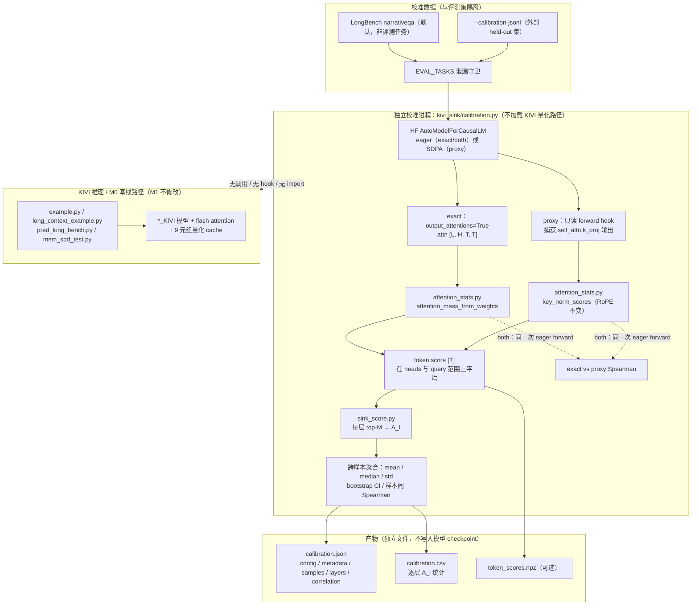

# KIVI Sink-Aware KV Cache 量化优化路线规划

> 依据：当前仓库实现、《KV Cache量化优化.md》研究方案、`docs/benchmark_runner.md` 与现有 LongBench/efficiency 基准入口。
>
> 目标：将文档提出的“层间异质性 Sink 保护预算分配 + 解码期延迟量化”从研究设想推进为可验证、可复现实验、可写论文的工程实现。
>
> 状态日期：2026-11-21（模型策略：Llama-first，Qwen2.5 后置到 M5.5，见第 10 节）

---

## 1. 项目现状盘点

### 1.1 已具备的基础

| 能力 | 当前状态 | 相关位置 |
|---|---|---|
| KIVI 模型实现 | 已支持 Llama / LongChat / Mistral 的 KIVI 路径，包含 K/V 量化、recent FP residual window、Flash/CUDA attention 路径 | `models/llama_kivi.py`、`models/mistral_kivi.py`、`quant/` |
| 统一 benchmark 入口 | 规划中：当前 checkout 尚未包含 `benchmark.py` / `benchmarks/`；现有入口为 `pred_long_bench.py` + `eval_long_bench.py` | `pred_long_bench.py`、`eval_long_bench.py` |
| LongBench 评价 | 已有 8 任务默认子集与 LongBench-E 13 任务；样本筛选需改代码 | `pred_long_bench.py`、`config/` |
| 效率评价 | `mem_spd_test.py` 提供固定 batch/长度下的耗时与 CUDA peak memory | `mem_spd_test.py` |
| 数据/模型解析 | 当前直接使用 HF `datasets` / `from_pretrained`；ModelScope 优先解析在路线中规划 | `utils/data.py`、`utils/process_args.py` |
| 研究设计 | 已明确研究问题、核心创新、baseline、消融、风险与 8 周初步计划 | `KV Cache量化优化.md` |

### 1.2 尚未具备的关键能力

1. **Attention 统计采集**：当前推理路径未提供统一的层/头/token attention score hook，Flash attention 下不能直接拿到完整注意力矩阵。
2. **Sink 分数与层间预算分配**：尚未实现 token sink score、top-M attention mass、KIVI fake-quant 重构误差和最大余数预算分配。
3. **Token 级保护路径**：当前 KIVI residual/full cache 基本按连续位置切分；尚未支持每层 scattered token indices 与 protected FP pool。
4. **Decode 延迟量化机制**：尚未实现解码期 score 更新、观察窗、滑出决策、动态 FP slot 与低频重排。
5. **Fake-quant 精度原型**：尚未提供“protected token 保持 FP、其他 token KIVI quantize/dequantize 后拼回”的独立原型。
6. **逻辑双池 cache 与分段 attention**：尚未实现 FP protected pool、KIVI quantized pool、recent FP window 的三段统一索引与 online softmax 合并。
7. **基准扩展**：当前 runner 已有 LongBench、synthetic efficiency 与 WikiText-2 PPL（`ppl_eval.py`），尚缺 RULER/NIAH、GSM8K、MBPP/HumanEval 等研究方案要求的评测。
8. **可复现实验管理**：当前 CSV 主要记录量化配置和总体指标，尚不足以完整记录 sink 策略、预算向量、校准集、随机种子、校准开销和 metadata 开销。

---

## 2. 总体目标与研究判断

### 2.1 总目标

在固定 KIVI 量化设定与固定有效 FP byte budget 下验证：

1. 基于层间 sink 依赖分数的 token 保护，是否优于 uniform、random、reverse、attention-only、quant-error-only 等分配策略；
2. 解码期延迟量化与动态 FP slot，是否优于仅在 prefill 后冻结保护集合或仅依赖 KIVI recent FP window；
3. 该方法在精度、显存、延迟和 metadata 开销之间能否取得可解释 trade-off。

### 2.2 技术主线

```text
Stage A: 可观察
    hook / fallback proxy 采集层、头、token attention 统计

Stage B: 可分配
    离线估计 layer score A_l / E_l / L_l
    按 FP byte budget 生成 P_l = S_l + D_l

Stage C: 可保护
    fake-quant：protected token 保持 FP，其他 token KIVI 量化后反量化
    验证算法精度收益

Stage D: 可解码
    decode score 更新 + 观察窗 + 单向 keep/quantize 决策 + 动态槽位

Stage E: 可系统化
    logical dual-pool cache + segmented attention
    真实显存/延迟 kernel 原型
```

### 2.3 分阶段主张控制

为避免系统实现风险影响研究结论，路线采用“结论逐级解锁”的方式：

| 阶段 | 允许的论文/报告主张 |
|---|---|
| Fake-quant 原型 | 只报告精度变化与理论 FP byte accounting，不声称真实显存节省或端到端加速 |
| Logical dual-pool | 可报告逻辑显存占用、Python/PyTorch 原型开销与正确性验证 |
| Segmented kernel | 才可报告端到端 latency、peak memory 与 tokens/s |

---

## 3. 路线阶段规划

## M0：Llama 原始项目跑通、基线冻结与模型策略确认

**周期建议：0.5–1 周**

### 目标

先在 Llama 路径上把原始 KIVI 项目完整跑通，获得可信、可复现的 FP16/BF16 与 KIVI 默认基线；同时确认整体模型策略为 **Llama-first（L1）**：M1–M5 全部在 `meta-llama/Llama-3.1-8B-Instruct` 上完成并冻结，Qwen2.5 的移植与跨模型复跑后置到 M5.5（见第 10 节）。M0 不接入 Qwen，避免把模型移植风险混入算法验证。

### 任务

#### M0.1 跑通 Llama 路径的原始项目

1. 安装与编译：
   - 按 `pyproject.toml` 安装主包：`pip install -e .`；
   - 编译 CUDA 算子：`cd quant && pip install -e .`；
   - 记录 GPU 型号、CUDA / PyTorch / Transformers / flash-attn 版本。
2. 静态检查：`python -m compileall models quant utils metrics.py`。
3. 示例链路：
   - `python example.py`（Llama-3.1-8B-Instruct，GSM8K 5-shot）；
   - `python long_context_example.py`（passkey 检索）；
   - `python mem_spd_test.py`（耗时与 peak memory；脚本默认是 Llama-2-7b，当前只做 Llama-3.1-8B，需显式传 `--model_name_or_path LLM-Research/Meta-Llama-3.1-8B-Instruct`）。
4. LongBench 链路：
   - 用 Llama-3.1-8B-Instruct 跑一组 smoke（Llama-2-7b 自 2026-11-26 起暂停，见 M0.2）；
   - 确认预测与评分链路正常，记录异常样本与长度。
5. 固定 KIVI 参数并记录：`k_bits`、`v_bits`、`group_size`、`residual_length`，确认 `residual_length` 是 `group_size` 的整数倍。
6. 整理 Llama 路径限制清单：
   - eager 路径仅支持 MHA，GQA 必须走 flash 路径；
   - 推理路径强制 `config.use_flash=True`；
   - 依赖固定在 `transformers==4.43.x`；
   - Llama-3.x 必须使用 fast tokenizer（根目录只有 `original/tokenizer.model`，slow 路径会报 `TypeError: not a string`）。

#### M0.2 确认模型策略（Llama-first，Qwen 后置）

1. 与用户确认第 10 节的 L1 执行模式：M1–M5 只使用 `meta-llama/Llama-3.1-8B-Instruct` 作为唯一模型。**Llama-2-7b（原 MHA 回归角色）自 2026-11-26 起暂停**，不进入 M0–M5 的任何实验、基线表与验收；MHA / eager 路径在本轮不做验证，留作后续需要时再补。
2. 确认 Qwen2.5 的角色：`Qwen/Qwen2.5-1.5B-Instruct` 用于 M5.5 移植开发与低成本复跑，`Qwen/Qwen2.5-7B-Instruct` 为最终主模型候选，但**不在 M0–M5 执行**。
3. 产出选型记录：模型 revision、选择理由、M5.5 的 Go/No-Go 条件与降级方案（见 10.3–10.4）。
4. 明确不做的事：M0 不新增 `models/qwen2_kivi.py`，不修改模型 loader，不引入 Qwen 专用 tokenizer/chat template 逻辑。

#### M0.3 冻结基线

1. 保存 FP16/BF16、KIVI 2-bit、可选 KIVI 4-bit 的 baseline。
2. 记录 seed、dtype、GPU、CUDA 版本、代码 commit 与 dirty 状态、完整配置。
3. 同配置重复运行至少 3 次，确认波动可解释。
4. **补充连续指标 PPL**：LongBench 的 F1/ROUGE/accuracy 粒度太粗，4k 截断下 2-bit 平均只掉 0.59 分，与评分噪声同量级；WikiText-2 的 perplexity 是逐 token 连续损失，对量化误差更灵敏。**必须在 decode 步测量**：KIVI 的 prefill attention 用的是全精度 K/V，量化只写进 cache 供后续步读取，任何"每窗一次 prefill"的指标（PPL、logits 差、hidden 差）对 2/4/16 bit 都恒等。PPL 一律**相对同一 commit 的 FP16 报告 delta**，不报绝对值。

> **执行约定（2026-11-26）**：先用单次评分结果冻结 `baseline_v1`（FP16 51.32 / KIVI-2bit 50.73 / KIVI-4bit 51.18，LongBench 8 任务、4k 截断），M1–M5 以此为对照锚；第 3 条「重复 3 次」推迟到有时间时补跑，补完发布 `baseline_v2`，`baseline_v1` 标记 superseded 但保留。详见 `docs/m0_llama_baseline.md` 第 3.1 节。

**为什么第 4 条只做 PPL、不做 RULER/NIAH**：仓库原本没有任何 PPL / RULER runner（见 1.2 节的评测缺口）。24GB 的 3090 已把 LongBench 截到 4096，而 NIAH / RULER 的价值在 32k–128k，4k 下几乎是送分题；同时长上下文的显存瓶颈是 `T × vocab` 的 logits 张量（4k ≈ 1.0GB、32k ≈ 7.8GB、120k ≈ 28.7GB，已超过整卡容量），而不是 KV（KIVI-2bit 每 token 约 16KB，FP16 为 128KB）。因此 M0 只补一个便宜且灵敏的 PPL 锚点，RULER / NIAH 仍留在 M3。

### 建议文件与模块

```text
config/model2path.json      # 补充 Llama-3.1-8B 与 Llama-2-7b 的路径/别名
config/model2maxlen.json    # 补充两个模型的 LongBench 有效长度
scripts/verify_llama_baseline.py  # 可选：Llama prefill/decode/9 元组 cache smoke
docs/                       # 记录环境、基线命令、模型策略与选型结论
```

Qwen2.5 相关文件（`models/qwen2_kivi.py`、Qwen loader 分支、Qwen 配置）统一在 M5.5 引入，不在 M0 创建。

### Llama 基线检查清单

1. **模型加载**
   - 使用 `LlamaForCausalLM_KIVI`，并设置 `config.use_flash=True`；
   - 量化参数必须在 `from_pretrained` 之前写入 config；
   - Llama-3.1-8B 走 GQA flash 路径（M0–M5 唯一验证路径）。eager / MHA 路径（原计划用 Llama-2-7b 覆盖）已暂停，不在 M0–M5 验收范围内。
2. **Cache 边界**
   - prefill 覆盖 `T <= R`、`T > R`、`T % R == 0` 三种切分；
   - decode 1 步与 `R+1` 步后，cache 形状与末位 `kv_seq_len` 正确。
3. **Tokenizer / prompt**
   - Llama-3.1 使用 `apply_chat_template`（Llama-2 原始 prompt 路径暂停）；
   - 生成参数在 FP 与 KIVI 之间保持完全一致。
4. **数值与功能验证**
   - KIVI 与 FP16 的 logits/PPL 偏差在预期范围，无 NaN；
   - 验证 `residual_length` 边界、RoPE 后 K 位置、causal mask 与 batch padding。
5. **基线命令**
   - `example.py`、`long_context_example.py` 与 LongBench smoke 各跑一次；
   - 保存模型 revision、tokenizer 配置、chat template hash 与生成参数。

### 验收标准

Llama 原始项目跑通：

- [x] `python -m compileall models quant utils metrics.py` 通过（2026-11-22，macOS / CPU-only）；
- [ ] CUDA 算子编译成功，`quant/gemv.py` 自测通过（待 GPU）；
- [ ] `example.py`、`long_context_example.py`、`mem_spd_test.py` 至少各成功运行一次（待 GPU）；
- [x] LongBench 预测与评分链路跑通（2026-11-26，Llama-3.1-8B 的 FP16 / KIVI-2bit / KIVI-4bit 均完成 8/8 任务预测并评分）；
- [ ] 已记录环境版本、KIVI 参数与 Llama 路径限制清单（固定参数与限制清单已完成，环境数值待 GPU 填写，见 `docs/m0_llama_baseline.md`）。

模型策略：

- [x] 已与用户确认 L1：M1–M5 使用 Llama-3.1-8B，Qwen2.5 后置到 M5.5；
- [x] 有书面选型记录，包含 Qwen 的角色、Go/No-Go 与降级方案（`docs/m0_llama_baseline.md`）；
- [x] M0 未引入任何 Qwen 专用代码或配置（已 grep 确认）；
- [x] 模型范围收敛：2026-11-26 起只在 `Llama-3.1-8B-Instruct` 上做实验，Llama-2-7b 暂停。

基线冻结：

- [x] Llama-3.1-8B 的 FP16 / KIVI-2bit / KIVI-4bit baseline 预测与分数已记录，并已冻结为 **`baseline_v1`**（51.32 / 50.73 / 51.18，见 `docs/m0_llama_baseline.md` 第 3.1、6.3 节）；
- [ ] 同配置重复运行至少 3 次，波动可解释（当前 2 次运行、仅 1 次评分；已按 `baseline_v1` 临时冻结，重跑后发布 `baseline_v2`）；
- [ ] PPL 补充指标已记录（FP16 参考 + KIVI-2bit / 4bit 的 delta）；`ppl_eval.py` 已就绪，命令见本节第 7 步，待 GPU 执行；
- [x] 失败 run 也落盘并保留错误原因（`scripts/m0_baseline.py run` 已落盘 30 次 `rc=1`，原因待汇总）；
- [x] 主模型与主量化配置已明确，后续实验不随意改变（L1 + KIVI 2/2/32/128，见 `docs/m0_llama_baseline.md`）。

### M0 当前实施状态

**进行中：Llama-3.1-8B 的 LongBench 预测与评分已完成；3 次重复、示例链路与峰值显存待补。** 2026-11-22 记录，2026-11-26 更新：

- M0.1 Llama 原始项目跑通：
  - ✅ 静态检查 `python -m compileall models quant utils metrics.py` 通过（macOS / CPU-only 环境）；
  - ✅ 模型配置补齐：`config/model2maxlen.json` 增加 `Llama-3.1-8B-Instruct` / `Meta-Llama-3.1-8B-Instruct`（原 120000；2026-11-25 因 3090 24GB 显存下调为 4096）与 `Llama-2-7b-ms`（4096），`config/model2path.json` 增加对应别名；
  - ✅ 兼容性修复：Llama-2 默认 ModelScope id 改为 `modelscope/Llama-2-7b-ms`（原 `LLM-Research/llama-2-7b-hf` 不存在）；Llama-3.x 改走 fast tokenizer（`utils/tokenizer_utils.py`），避免 slow tokenizer 在无根目录 `tokenizer.model` 时报 `TypeError: not a string`；
  - ✅ 基线记录工具 `scripts/m0_baseline.py`（`check` / `env` / `run`）；
  - ✅ 数据集本地优先 + ModelScope：`utils/modelscope_hub.py` 新增 `load_long_bench_task` / `load_gsm8k_split`。下载前依次检查 `--data_dir`（或 `LONGBENCH_DATA_DIR` / `GSM8K_DATA_DIR`）、`<cache_dir>/longbench/data` 与 `<cache_dir>/gsm8k` 的已解压副本、本机 ModelScope snapshot；都没有才下载 LongBench `ZhipuAI/LongBench` 的 `data.zip`（约 114 MB）或 `modelscope/gsm8k` 声明的 jsonl。`pred_long_bench.py` / `example.py` 不再访问 `huggingface.co`（`--data_source hf` 仍可显式切回）；
  - ✅ 默认下载目录：未显式传 `--cache_dir` 时，ModelScope 模型落 `~/data/modelscope/`，HF 模型落 `~/data/hf/hub/`，HF 数据集落 `~/data/hf/datasets/`，LongBench / GSM8K 解压副本落 `~/data/datasets/{longbench,gsm8k}/`；根目录可用 `KIVI_DATA_DIR` 覆盖；
  - ⏳ CUDA 算子编译、`quant/gemv.py`、`example.py`、`long_context_example.py`、`mem_spd_test.py` 待 GPU 机器执行（LongBench 预测与评分链路已于 2026-11-26 跑通）。
- M0.2 模型策略确认：✅ 已与用户确认 **L1**；书面选型记录见 `docs/m0_llama_baseline.md`；M0 未引入任何 Qwen 代码/配置（已 grep 确认）。
- M0.3 基线冻结：✅ 2026-11-26 在 8×RTX 3090 上完成 Llama-3.1-8B 的 FP16 / KIVI-2bit / KIVI-4bit 各 2 次完整预测（`rc=0`，8/8 任务），并对第 2 次预测评分；**该结果已指定为 `baseline_v1`**（FP16 51.32 / KIVI-2bit 50.73 / KIVI-4bit 51.18），M1–M5 以它为对照锚，详见 `docs/m0_llama_baseline.md` 第 3.1、6.3 节。⏳ 仍缺：PPL 补充指标（`ppl_eval.py` 已就绪，待执行）、第 3 次重复与独立评分（重跑后发布 `baseline_v2`）、峰值显存（需 `mem_spd_test.py`）、`example.py` / `long_context_example.py` 示例链路。Llama-2-7b 组暂停执行。

非 GPU 环境说明：当前开发机为 macOS、无 NVIDIA GPU、CPU-only torch 2.15，项目依赖（transformers / datasets / modelscope / triton / flash-attn）未安装，因此 GPU 项无法在本机完成。

### M0 验证命令

非 GPU 部分（当前机器可执行）：

```bash
# 静态检查
python -m compileall models quant utils metrics.py

# 数据集加载：本地优先，缺失时才从 ModelScope 下载（无 GPU 即可验证）
# 第二次执行应只打印 loading ...，不再出现 downloading
python - <<'PY'
from utils.modelscope_hub import load_long_bench_task, load_gsm8k_split
print(len(load_long_bench_task("qasper", cache_dir="./cached_models")))
print(len(load_gsm8k_split("test", cache_dir="./cached_models")))
PY

# 默认下载根目录：默认 ~/data，KIVI_DATA_DIR 可覆盖
KIVI_DATA_DIR= python - <<'PY'
from utils.modelscope_hub import default_data_root
print(default_data_root())
PY

# 固定量化配置校验（residual_length 必须是 group_size 的整数倍）
python scripts/m0_baseline.py check \
    --k-bits 2 --v-bits 2 --group-size 32 --residual-length 128

# 环境 / 版本 / git 状态记录（GPU 机器上执行，结果补入 docs/m0_llama_baseline.md）
python scripts/m0_baseline.py env --out results/m0_baselines/env.json
```

当前验证状态（2026-11-22）：静态检查通过；`m0_baseline.py check` 对冻结配置返回 `ok: true`、对 `residual_length=100, group_size=32` 正确报错。CUDA、示例、LongBench 与基线重复运行均待 GPU 执行，结果将补入 `docs/m0_llama_baseline.md`。

### M0 GPU 验证命令（待执行）

以下命令需要在具备 NVIDIA GPU、CUDA toolkit 与完整依赖的机器上按顺序执行；结果补回 `docs/m0_llama_baseline.md`。

#### 1. 安装与编译

```bash
conda create -n sinkbudget python=3.10 -y
conda activate sinkbudget
pip install --upgrade pip
pip install -e .

# CUDA 扩展必须关闭 build isolation，否则隔离构建环境里没有 torch
cd quant
pip install -e . --no-build-isolation
cd ..
```

#### 2. 环境记录与配置校验

```bash
python scripts/m0_baseline.py env --out results/m0_baselines/env.json
python scripts/m0_baseline.py check \
    --k-bits 2 --v-bits 2 --group-size 32 --residual-length 128
```

#### 3. 静态检查与 CUDA 算子自测

```bash
python -m compileall models quant utils metrics.py

# 注意：quant/gemv.py 与 quant/test.py 顶部硬编码了 CUDA_VISIBLE_DEVICES=2，
# 运行前按机器情况调整。
python quant/gemv.py
(cd quant && python test.py)
```

#### 4. 示例链路

```bash
python example.py
python long_context_example.py
python mem_spd_test.py
```

#### 5. LongBench smoke（Llama-3.1-8B）

```bash
bash scripts/long_test.sh 0 2 2 32 128 LLM-Research/Meta-Llama-3.1-8B-Instruct
python eval_long_bench.py --model Meta-Llama-3.1-8B-Instruct_4096_2bits_group32_residual128
```

Llama-2-7b 的对应命令（`bash scripts/long_test.sh 0 2 2 32 128 modelscope/Llama-2-7b-ms`）自 2026-11-26 起暂停，仅保留备查。

#### 6. 基线矩阵：每个配置重复 3 次

成功与失败尝试都由 `scripts/m0_baseline.py run` 落盘到 `results/m0_baselines/`。

Llama-2-7b-ms（ModelScope 默认；HF 等价 `meta-llama/Llama-2-7b-hf`）—— **自 2026-11-26 起暂停，不执行**，命令保留备查：

```bash
python scripts/m0_baseline.py run --name llama2_fp16_longbench --repeat 3 -- \
    bash scripts/long_test.sh 0 16 16 32 128 modelscope/Llama-2-7b-ms
python scripts/m0_baseline.py run --name llama2_kivi2_longbench --repeat 3 -- \
    bash scripts/long_test.sh 0 2 2 32 128 modelscope/Llama-2-7b-ms
python scripts/m0_baseline.py run --name llama2_kivi4_longbench --repeat 3 -- \
    bash scripts/long_test.sh 0 4 4 32 128 modelscope/Llama-2-7b-ms
```

Llama-3.1-8B-Instruct

```bash
python scripts/m0_baseline.py run --name llama31_fp16_longbench  -- \
    bash scripts/long_test.sh 0 16 16 32 128 LLM-Research/Meta-Llama-3.1-8B-Instruct
python scripts/m0_baseline.py run --name llama31_kivi2_longbench  -- \
    bash scripts/long_test.sh 0 2 2 32 128 LLM-Research/Meta-Llama-3.1-8B-Instruct
python scripts/m0_baseline.py run --name llama31_kivi4_longbench  -- \
    bash scripts/long_test.sh 0 4 4 32 128 LLM-Research/Meta-Llama-3.1-8B-Instruct
```

三张 3090 并行跑三组配置（推荐；每组独立 `--out-dir`，避免 `env.json` / `manifest.jsonl` 并发覆盖）：

```bash
mkdir -p logs

nohup env CUDA_DEVICE_ORDER=PCI_BUS_ID \
    python scripts/m0_baseline.py run \
    --out-dir results/m0_baselines/llama31_fp16 \
    --name llama31_fp16_longbench --repeat 2 -- \
    bash scripts/long_test.sh 4 16 16 32 128 LLM-Research/Meta-Llama-3.1-8B-Instruct \
    > logs/llama31_fp16.log 2>&1 &

nohup env CUDA_DEVICE_ORDER=PCI_BUS_ID \
    python scripts/m0_baseline.py run \
    --out-dir results/m0_baselines/llama31_kivi2 \
    --name llama31_kivi2_longbench --repeat 2 -- \
    bash scripts/long_test.sh 5 2 2 32 128 LLM-Research/Meta-Llama-3.1-8B-Instruct \
    > logs/llama31_kivi2.log 2>&1 &

nohup env CUDA_DEVICE_ORDER=PCI_BUS_ID \
    python scripts/m0_baseline.py run \
    --out-dir results/m0_baselines/llama31_kivi4 \
    --name llama31_kivi4_longbench --repeat 2  -- \
    bash scripts/long_test.sh 7 4 4 32 128 LLM-Research/Meta-Llama-3.1-8B-Instruct \
    > logs/llama31_kivi4.log 2>&1 &

wait
```

- 三组分别占 GPU 0/1/2，各自独立加载 8B 模型，不做模型切分；
- 首次并行前先确认 LongBench 数据已缓存，避免三个进程同时下载/解压；
- 先做链路 smoke 时可把 `--repeat 3` 改为 `--repeat 1`；
- `wait` 只等三组结束，不合并结果；分数仍需分别跑 `eval_long_bench.py`。

注意：`long_test.sh` 每次运行会覆盖同名 `pred/` 目录。若需保留逐次分数，把评分与结果复制接进 `run` 命令：

```bash
python scripts/m0_baseline.py run --name llama31_kivi2_r1 --repeat 1 -- \
    bash -c 'bash scripts/long_test.sh 0 2 2 32 128 LLM-Research/Meta-Llama-3.1-8B-Instruct && \
             python eval_long_bench.py --model Meta-Llama-3.1-8B-Instruct_4096_2bits_group32_residual128 && \
             cp pred/Meta-Llama-3.1-8B-Instruct_4096_2bits_group32_residual128/result.json \
                results/m0_baselines/llama31_kivi2_r1_result.json'
```

#### 7. PPL 补充基线

LongBench 在 4k 截断下降幅太小（2-bit 平均 −0.59），需要连续指标补充判读。`ppl_eval.py` 用 WikiText-2 算逐 token 的**续写损失（在 decode 步测量）**，**固定相对 FP16 报告 delta**。

```bash
# 1) FP16 参考（先跑这个，后面都以它为基准）
nohup python ppl_eval.py \
    --model_name_or_path LLM-Research/Meta-Llama-3.1-8B-Instruct \
    --device 7 --k_bits 16 --v_bits 16 \
    --json_out results/sink/ppl/llama31_fp16_4k.json

# 2) KIVI-2bit / 4bit，直接打印 delta
nohup python ppl_eval.py \
    --model_name_or_path LLM-Research/Meta-Llama-3.1-8B-Instruct \
    --device 7 --k_bits 2 --v_bits 2 \
    --reference results/sink/ppl/llama31_fp16_4k.json \
    --json_out results/sink/ppl/llama31_kivi2_4k.json

nohup python ppl_eval.py \
    --model_name_or_path LLM-Research/Meta-Llama-3.1-8B-Instruct \
    --device 7 --k_bits 4 --v_bits 4 \
    --reference results/sink/ppl/llama31_fp16_4k.json \
    --json_out results/sink/ppl/llama31_kivi4_4k.json
```

口径（不要改，否则跨阶段不可比）：

- **只在 decode 步测量**。KIVI 的 prefill attention 用的是刚投影出来的全精度 K/V，量化发生在其后、只写进 cache（`models/llama_kivi.py` 里 `_flash_attention_forward` 在前，打包在后）。因此"每窗一次 prefill"的 PPL 对 2/4/16 bit **逐位相同**——2026-11-27 实测三组 `nll_sum` 完全一致，就是在这一步踩的坑。脚本现在的口径是「512 token 前缀 prefill + 2048 步 teacher-forced decode」，每个评分位置都读取量化后的历史。
- 报告的指标是**「给定前缀后的续写损失」**，不是标准 WikiText PPL：三组之间可比，但**不能**与 KIVI 论文的 PPL 绝对值相比。JSON 里 `metric` 字段固定标注。
- 窗口 `--windows 8`，在语料上等距取；贪心解码、无采样，`--batch_size 8` 只影响并发窗口数，不影响数值。
- 不能改成"整块 chunk + past 一起喂"：KIVI 的 decode 分支断言 `value_full_length == residual_length + 1`，只支持单 token 增量。
- 数据三级优先：`--data_file` → `<KIVI_DATA_DIR>/datasets/wikitext/wikitext-2-raw-v1_test.txt` → 本地 `wikitext.py` 数据集脚本（`datasets.load_dataset`，不经过 `modelscope.msdatasets`，规避 `datasets==2.16.1` 的 `LargeList` 导入失败）。首次跑完缓存成纯文本，之后离线可跑。
- 只报相对 FP16 的 `delta`，不报绝对 PPL：instruct 模型续写 WikiText 的绝对值没有意义。
- `--reference` 与 `--json_out` 不得指向同一文件（脚本已加硬检查；出现 `delta: +0.0000 (+0.00%)` 说明自比了）。
- 显存：前缀 prefill 的 logits 是 `windows × prefill_length × vocab`，8×512 时约 1.0 GB；权重 15 GB，整机约 19 GB。默认参数下每个配置约 3–5 分钟（2048 步 decode）。

#### 8. 结果归档

- 把各 `--out-dir` 下的 `env.json`（如 `results/m0_baselines/llama31_fp16/env.json`）中的 GPU / CUDA / 依赖版本填入 `docs/m0_llama_baseline.md` 第 4 节；
- 把 3 次重复的分数与波动填入第 6.3 节；
- 把 PPL 的 `delta`（FP16 / KIVI-2bit / KIVI-4bit）填入第 6.3 节，JSON 放在 `results/sink/ppl/`；
- 把失败 run 的 `returncode` / `stderr` 与原因填入第 8 节；
- 全部通过后，把本节 M0 验收勾选更新为完成。

---

## M1：Attention 统计与 Sink 分数原型

**周期建议：1 周**

### 目标

先实现“可观察”，解决所有后续策略依赖的核心数据源。

### M1 架构图

M1 的关键边界是：**校准在独立进程内完成，KIVI 推理路径完全不变**。exact 与 proxy 只是 token score 的两种来源，后续的 top-M、`A_l`、跨样本聚合与相关性报告共用同一套代码。



读图要点：

- **exact** 走 HF eager 的 `output_attentions=True`，直接得到 causal attention 矩阵；**proxy** 走 SDPA + 只读 `k_proj` hook，用 key norm 作为 flash-compatible 替代。两种模式都不修改模型输出。
- `both` 模式在同一次 eager forward 中同时收集 exact attention 与 `k_proj`，因此可以逐层报告 token score 的 Spearman 相关性和逐样本 `A_l` 相关性。
- 所有产物写到 `results/sink/calibration/`，与模型权重、KIVI cache、M0 基线记录分离；校准进程不会向 KIVI 路径注册 hook，也不会改变基准/生成进程。

### 任务

1. 新建 calibration 模块，不侵入 KIVI 主路径：
   ```text
   kivi_sink/
     __init__.py
     attention_stats.py
     sink_score.py
     calibration.py
   ```
2. 支持两种统计模式：
   - **exact mode**：小模型或单层诊断使用 eager/sdpa attention，导出 attention score；
   - **flash-compatible mode**：主模型若无法直接取 attention，则使用 fallback proxy，并单独验证 proxy 与 exact score 的相关性。
3. 实现 token sink score：
   - 对 prefill query 和 head 求平均；
   - 可配置使用全部 query 或最后 25% query；
   - 按 batch sample 独立统计，避免跨样本混淆。
4. 实现层间 sink 依赖：
   - 每层取 token score top-M；
   - 累加 attention mass；
   - 跨校准样本 mean / median 聚合；
   - 输出稳定性指标与 bootstrap 区间。
5. 建立校准数据入口：
   - 第一阶段可使用 LongBench 长输入任务外的公开校准集；
   - 必须与测试集隔离，避免数据泄漏。
6. 增加单元测试：
   - causal mask 正确性；
   - score 归一化范围；
   - top-M 排序；
   - 多 batch/多 head 聚合。

### 关键设计约束

- Hook 只读，不改变模型权重与生成结果；
- exact mode 用于算法研究，不作为第一阶段效率结论依据；
- score 缓存使用独立文件，不混入模型 checkpoint。
- **M1 只新增 `kivi_sink/` 与 `tests/`，不修改 `models/`、`quant/`、`pred_long_bench.py`、`eval_long_bench.py`、`utils/` 的默认执行路径**；M0 的 LongBench / smoke / `mem_spd_test.py` 指标必须能在 M1 后原样复现。
- exact mode 通过独立的校准进程（独立加载 HF eager/sdpa 模型，或只读 `register_forward_hook` 重算 QK^T）实现；**不得放宽 `LlamaAttention_KIVI` 的 `use_flash=True` 断言，不得让 KIVI 主路径退回 sdpa/eager**。
- 不在 attention forward 热路径插入统计分支；需要 hook 时只在**校准进程**内注册，基准/生成进程不注册任何 hook。
- 模块 import 时不修改全局状态（随机种子、`torch.backends.*`、`torch.use_deterministic_algorithms`、默认 dtype 等）；校准 seed 仅在校准进程内设置。
- 新增依赖只进入测试/校准的可选依赖，**不改变 `pyproject.toml` 中 torch / transformers / flash-attn 的版本约束**。
- 校准数据加载不改变 `utils/modelscope_hub.py` 等共享 loader 的既有行为；如需扩展，新增参数默认保持现状。

### 交付物

- `kivi_sink/attention_stats.py`
- `kivi_sink/sink_score.py`
- `kivi_sink/calibration.py`
- `kivi_sink/report.py`
- `tests/test_sink_score.py`、`tests/test_report.py`
- 校准统计 JSON/CSV 示例

### 验收标准

- [ ] 能为每个样本输出每层 token score；
- [ ] 能汇总得到 `A_l` 与跨样本稳定性；
- [ ] exact 与 proxy 模式的 Spearman 相关报告可用；
- [ ] 校准过程不改变原模型输出。
- [ ] 路径隔离检查：`git diff <M0 基线冻结 commit>..<M1 commit> -- models/ quant/ pred_long_bench.py eval_long_bench.py utils/` 为空，或只包含已记录且不影响默认执行路径的改动；
- [ ] M0 回归检查：用 M0 冻结的配置与 seed 重跑 LongBench、`mem_spd_test.py` 与 `ppl_eval.py`，分数在既定容差内，耗时与峰值显存无系统性变化；若有变化，记录原因并重新基线化，不允许静默覆盖 M0 数字。对照锚为 `baseline_v1`（FP16 51.32 / KIVI-2bit 50.73 / KIVI-4bit 51.18）；PPL 以 FP16 的 delta 为准。**注意**：`baseline_v1` 是单次评分、没有方差，因此容差只能先按约定值取（建议 LongBench 逐任务 ±1.0 分、平均 ±0.5 分，贪心解码下理想值应为 0；PPL 建议相对 delta ±0.5%），等 `baseline_v2` 有 3 次重复后再换成实测方差。

### M1 指标验证

校准产物由 `kivi_sink/calibration.py` 生成，统一用 `kivi_sink/report.py` 计算 M1 指标并给出 `pass / warn` 告警。M1 验证的不是精度收益，而是“统计量是否可用”。

#### 指标定义与判读

| 指标 | 来源字段 | 含义 / 判读 |
|---|---|---|
| `A_l` | `layers[].{exact,proxy}_A_mean` | 每层 top-M token 的归一化分数占比；exact 模式下即 top-M attention mass |
| 层间异质性 | `A_l` 的 range / CV / `excess_over_uniform` | range 与 CV 越大，层间差异越明显；`excess_over_uniform = mean(A_l) - top_M/T` 表示相对均匀分配的额外集中度 |
| 跨样本稳定性 | `correlation.*_layer_A_stability_spearman` | 校准样本之间 `A_l` 排序的一致性；低于阈值说明预算向量可能随样本翻转 |
| proxy token 相关性 | `correlation.token_spearman_per_layer` | exact 与 key-norm proxy 在逐 token 分数上的 Spearman |
| proxy 层分数相关性 | `correlation.layer_A_spearman_per_sample` | 两种分数得到的 `A_l` 排序是否一致 |
| CI 宽度 | `layers[].*_ci_low/high` | bootstrap 均值区间宽度，反映样本量是否足够 |

默认工程护栏：token Spearman ≥ 0.5、layer-A Spearman ≥ 0.5、跨样本稳定性 ≥ 0.7、可用样本数 ≥ 3；均可在命令行覆盖。这些阈值只用于发现实现或数据问题，不作为研究结论。

#### 当前可执行（CPU，无需模型）

```bash
python -m compileall kivi_sink tests
python -m unittest discover -s tests -v          # 67 项，含指标 report 的正负例

# 合成数据：验证指标计算与告警链路（随机 Q/K，不是研究信号）
python -m kivi_sink.calibration --synthetic --mode both \
    --samples 3 --synthetic-layers 4 --max-length 64 --top-m 2 \
    --output results/sink/calibration/synthetic.json
python -m kivi_sink.report \
    --input results/sink/calibration/synthetic.json \
    --min-samples 3 \
    --json-out results/sink/calibration/synthetic.report.json
```

合成数据的 proxy 相关性与稳定性通常低于阈值，这是预期结果：它只证明 report 的告警逻辑有效，不能据此判断 key-norm proxy 在真实模型上无效。

#### 研究指标（GPU，待执行）

```bash
# 1) exact 与 proxy 在同一次 eager forward 中采集
python -m kivi_sink.calibration \
    --model LLM-Research/Meta-Llama-3.1-8B-Instruct \
    --mode both --max-length 512 --samples 8 \
    --output results/sink/calibration/llama31_both.json \
    --save-token-scores results/sink/calibration/llama31_both.npz

# 2) 计算 M1 指标与告警
python -m kivi_sink.report \
    --input results/sink/calibration/llama31_both.json \
    --min-samples 8 \
    --json-out results/sink/calibration/llama31_both.report.json

# 3) 长上下文 proxy 校准（不物化 attention）
python -m kivi_sink.calibration \
    --model LLM-Research/Meta-Llama-3.1-8B-Instruct \
    --mode proxy --max-length 4096 --samples 16 \
    --output results/sink/calibration/llama31_proxy.json
python -m kivi_sink.report \
    --input results/sink/calibration/llama31_proxy.json --min-samples 16
```

判读顺序：

1. 先看 `layer_heterogeneity` 与 `excess_over_uniform`。若 `A_l` 接近 `top_M/T` 且层间 range 很小，说明层间 sink 差异不显著，按风险表转向 `E_l` 或 head 级统计。
2. 再看 `proxy_token_spearman` / `proxy_layer_spearman`。若相关性不足，exact 仅用于短窗口诊断，长上下文结论必须换更强 proxy（如 logit-LSE / activation outlier）。
3. 同时看 `cross_sample_stability` 与 `ci_width`。稳定性低时增加校准样本、改用 median 聚合或缩小 query 范围，并报告多校准集一致性。
4. 最后执行 M0 回归与路径隔离检查；`report` 只读取校准 JSON，不加载模型、不修改任何基线产物。

---

## M2：Fake-quant 保护与层间预算分配

**周期建议：1–1.5 周**

### 目标

在不修改 CUDA kernel 的情况下验证核心算法收益。

### 任务

1. 实现 KIVI fake-quant 工具：
   - K per-channel；
   - V per-token；
   - quantize → dequantize → 拼回 FP tensor；
   - 保持与 KIVI 主实现一致的 group 语义。
2. 实现 scale-preserving protection：
   - 按原始 KIVI 流程计算 scale；
   - protected token 不参与 fake-quant 后的低精度替换；
   - 非保护 token 保持原 KIVI 语义。
3. 实现在线 prefill token 选择：
   - 每层选择 top `S_l`；
   - 默认强制 position 0；
   - 支持 current-sequence attention score 与 oracle score。
4. 实现层间分配：
   - attention-only：`A_l`；
   - quant-error-only：`E_l`；
   - combined：`L_l = A_l * (1 + lambda * E_l)`；
   - uniform、random、reverse；
   - 最大余数法保证总预算；
   - 约束 `1 <= P_l <= P_max`；
   - 动态槽位比例 `eta`。
5. 实现预算序列化：
   ```json
   {
     "model": "...",
     "calibration_set": "...",
     "metric": "combined",
     "lambda": 0.5,
     "total_budget": 256,
     "P": [4, 10, 2],
     "S": [3, 8, 1],
     "D": [1, 2, 1],
     "R": 128
   }
   ```
6. 先做 oracle 小规模验证：
   - top 1/2/4/8；
   - 若 oracle 无收益，及时停止复杂工程并回到指标设计。

### 建议文件

```text
kivi_sink/
  fake_quant.py
  allocation.py
  selection.py
  config.py
models/*_kivi.py       # 只加最小 hook/开关，不直接大改主路径
tests/test_allocation.py
tests/test_fake_quant.py
```

### 验收标准

- [ ] fake-quant 输出与原 KIVI 数值路径在容差内一致；
- [ ] protected token 的 K/V dtype/数值保持 FP；
- [ ] 所有分配策略满足相同总 FP byte budget；
- [ ] oracle top-k 能产生可复现的正向信号；
- [ ] 层间分数与代表层保护收益的相关性初步可见。

---

## M3：主 baseline 矩阵与长上下文精度实验

**周期建议：1–1.5 周**

### 目标

回答研究问题 1：相同预算下，层间异质性分配是否真正优于常规策略。

### 任务

1. 扩展 `benchmark.py` 或新增 experiment runner，支持：
   - `sink_mode`: none / uniform / random / reverse / attention / quant_error / combined / oracle；
   - `total_budget`、`eta`、`lambda`、`top_m`；
   - budget plan 路径与校准集 ID；
   - position 0 是否强制保护。
2. 保持公平对比：
   - 相同模型、tokenizer、生成参数；
   - 相同 KIVI bits/group/recent window；
   - 相同有效 FP byte budget；
   - 报告 metadata 与索引开销。
3. 建立主 baseline：
   - FP16/BF16；
   - KIVI default；
   - Uniform-N；
   - attention-only；
   - quant-error-only；
   - combined；
   - random；
   - reverse；
   - oracle token selection。
4. 优先评测仓库已有 LongBench 长输入短输出任务；
5. 补充 PPL 与 RULER/NIAH runner：
   - PPL：`ppl_eval.py` 已在 M0 落地（WikiText-2、4096 窗口、相对 FP16 报 delta），M3 直接复用同一口径，不另写实现；
   - RULER/NIAH：先实现可复现小子集（24GB 单卡下受 logits 张量限制，先做 ≤8k 的版本）；
   - 输出逐任务分数与平均分。
6. 结果表格必须区分：
   - 算法收益；
   - 额外 FP 存储；
   - 校准/在线统计开销。

### 实验记录建议

```text
results/sink/
  plans/*.json
  runs/*.jsonl
  summaries/*.csv
```

### 验收标准

- [ ] 每个方法至少 3 个随机种子或明确说明确定性任务；
- [ ] 主表格包含精度、理论 FP bytes/token、metadata 估计；
- [ ] 主表格同时给出 Δ 相对 `baseline_v1` 的 FP16（51.32）与 KIVI-default（50.73）两列，方法间差异以此为准，不只报绝对分数；
- [ ] combined 相对 uniform/random/reverse 有稳定增益，或形成明确负结果结论；
- [ ] oracle 与实际分配差距可量化。

---

## M4：Decode 延迟量化与动态槽位仿真

**周期建议：1–1.5 周**

### 目标

回答研究问题 2：新生成 token 是否需要观察期与动态 keep/quantize 决策。

### 任务

1. 实现 decode score 更新：
   - exact attention 可得时累积 attention；
   - 否则使用 key similarity / activation outlier proxy；
   - 记录 score 更新频率与开销。
2. 实现 recent observation window：
   - 新 token 先 FP；
   - 滑出观察窗时一次性决策。
3. 实现单向精度转换：
   - FP → low-bit；
   - 已量化 token 不恢复 FP；
   - 动态 FP slot 中的低分 token 可被替换并量化。
4. 实现两种第一版策略：
   - threshold-only；
   - score-rank replacement。
5. 低频重排作为可选增强，不作为阻塞项。
6. 先做 simulation / fake-quant：
   - 用张量索引模拟 cache 状态迁移；
   - 统计 keep/quantize/evict 次数；
   - 验证不会出现越界、重复保护、causal mask 泄漏。
7. 长输出任务接入：
   - GSM8K；
   - MBPP/HumanEval 可先小规模；
   - LongBench 中输出较长的任务。

### 建议文件

```text
kivi_sink/
  decode_policy.py
  dynamic_slots.py
  metrics.py
tests/test_decode_policy.py
benchmarks/gsm8k.py
benchmarks/ruler.py
```

### 验收标准

- [ ] decode 每步额外计算与内存可测量；
- [ ] 状态迁移满足预算约束与单向转换规则；
- [ ] Full dynamic method 与 Combined static + recent window 可直接对比；
- [ ] 长输出任务显示出观察窗必要性，或得到可解释负结果。

---

## M5：Logical dual-pool cache 与分段 attention

**周期建议：1–2 周**

### 目标

把 fake-quant 的逻辑保护变成接近真实 cache 结构，但不立即修改底层 CUDA kernel。

### 任务

1. 定义每层 cache 状态：
   ```text
   FP protected pool: scattered token indices
   KIVI quantized pool: compressed K/V + scale/min
   recent FP window: contiguous latest R tokens
   ```
2. 保证三段互斥，处理边界：
   - protected token 位于 recent window；
   - recent token 滑出并进入 dynamic slot；
   - dynamic slot token 被替换并量化；
   - batch padding 与 left/right padding；
   - RoPE 后 K 与原始 V 的位置对应。
3. 实现分段 attention：
   - FP segment 普通 attention；
   - quantized segment dequantize 后 attention；
   - online softmax 合并；
   - causal mask 正确。
4. 实现逻辑显存统计：
   - FP pool bytes；
   - quantized pool bytes；
   - scale/min/metadata；
   - effective bits/token。
5. 建立正确性测试：
   - 与 fake-quant dense attention 输出对齐；
   - 与 FP attention 在空量化池/空保护池时对齐；
   - 多步 decode 后索引一致。
6. 性能测试仅报告原型开销，不冒充 kernel 收益。

### 建议文件

```text
kivi_sink/
  cache_state.py
  dual_pool_cache.py
  segmented_attention.py
  memory_accounting.py
tests/test_dual_pool.py
```

### 验收标准

- [ ] 三段 cache 无重复、无遗漏；
- [ ] 多步 decode 后 attention 输出与 dense fake-quant 参考一致；
- [ ] 理论显存与实际 tensor 元素数一致；
- [ ] 能稳定完成长上下文生成。

M5 验收通过后进入 **M5.5（Qwen2.5 移植与跨模型复跑）**，详见第 10 节；M5.5 不阻塞 M6/M7 的 Llama 结果整理。

---

## M6：效率系统化与 kernel 原型

**周期建议：1–2 周，允许降级**

### 目标

在精度结论成立后，评估真实系统价值。该阶段是高风险增量，不应阻塞论文主体。

### 任务

1. 先做 profiling：
   - attention 时间；
   - score 更新时间；
   - index 维护时间；
   - quantize/dequantize 时间；
   - Python 开销占比。
2. 确定 kernel 修改范围：
   - decode 优先，prefill 其次；
   - 单 batch/固定 head 维度优先；
   - 避免一开始追求完整 vLLM 集成。
3. kernel 原型需求：
   - scattered FP indices；
   - FP/quantized 双格式；
   - online softmax；
   - decode slot 更新；
   - 与 RoPE 后 K/V layout 兼容。
4. 对照组：
   - KIVI 原路径；
   - dense dequantize path；
   - logical dual-pool；
   - segmented kernel。
5. 若 kernel 无法按期完成，正式降级为：
   - fake-quant accuracy；
   - logical dual-pool correctness；
   - theoretical memory accounting；
   - profiling bottleneck 分析。

### 交付物

- profiling 报告；
- kernel prototype 或降级说明；
- latency/tokens/s/peak memory 表。

### 验收标准

- [ ] 有明确 profile 热点；
- [ ] 若报告加速，必须包含相同输出长度与相同 KV 状态；
- [ ] 不因 Python 原型开销得出错误的 kernel 结论。

---

## M7：消融、论文与复现包

**周期建议：1 周**

### 目标

把实验从“能跑”整理成可信研究结论。

### 任务

1. 补齐全消融：
   - 总预算 `P`；
   - top-M；
   - lambda；
   - dynamic slot 比例 eta；
   - recent window R；
   - decode 重排间隔 T；
   - 校准样本数；
   - query 范围。
2. 重新冻结代码与预算文件：
   - 不允许实验后无记录地修改 plan；
   - 保存 git commit 与配置 hash。
3. 汇总图表：
   - 层间预算分布；
   - attention mass 分布；
   - 预算-精度曲线；
   - oracle gap；
   - keep/quantize 比例；
   - memory/latency trade-off；
   - 校准稳定性。
4. 论文叙事：
   - 问题：全局统一 sink 保护忽略层间异质性与 decode 新 token 的观察期；
   - 方法：离线预算分配 + 在线 token 选择 + 延迟量化；
   - 证据：相同 FP byte budget 下的 baseline 矩阵与消融；
   - 边界：fake-quant / logical pool / kernel 的主张分层。
5. 复现包：
   - 一键安装；
   - 一键下载模型/数据；
   - 一键跑 smoke；
   - 一键生成主表；
   - README 明确 GPU 与依赖版本。

### 验收标准

- [ ] 主表每个数字可由日志与配置追溯；
- [ ] 消融覆盖核心超参；
- [ ] 负结果或降级结论明确；
- [ ] 第三方能在相同 GPU 环境复现 smoke test。

---

## 4. 推荐目录演进

当前仓库已有 `models/`、`quant/`、`benchmarks/`。建议新增独立 `kivi_sink/`，避免一开始大改上游 KIVI 模型代码：

```text
kivi_sink/
  __init__.py
  config.py               # SinkConfig 与实验配置
  calibration.py          # 校准流程
  attention_stats.py      # exact/proxy attention 统计
  sink_score.py           # token score / layer score
  fake_quant.py           # KIVI fake-quant 与 protected mask
  allocation.py           # 层间预算分配
  selection.py            # prefill token selection
  decode_policy.py        # decode 决策
  dynamic_slots.py        # 动态槽位状态机
  cache_state.py          # 三段 cache 元数据
  dual_pool_cache.py      # logical dual-pool
  segmented_attention.py  # 分段 attention
  memory_accounting.py    # 显存与 metadata 统计

benchmarks/
  runner.py               # 现有 LongBench/efficiency
  sink_runner.py          # sink 实验编排
  ppl.py
  ruler.py
  gsm8k.py
  codegen.py

tests/
  test_sink_score.py
  test_allocation.py
  test_fake_quant.py
  test_decode_policy.py
  test_dual_pool.py

results/sink/
  plans/
  runs/
  summaries/
```

---

## 5. 关键里程碑与时间线

以研究方案原有 8 周计划为基础，按 **Llama-first（L1）** 调整为更可执行的节奏：M0–M5 全部在 `Llama-3.1-8B-Instruct` 上完成并冻结，Qwen2.5 的移植与跨模型复跑放在 M5.5：

| 时间 | 里程碑 | 关键输出 | Go / No-Go |
|---|---|---|---|
| 第 0.5–1 周 | M0 Llama 跑通、基线冻结与模型策略确认 | Llama-3.1-8B 基线（Llama-2 已暂停）、环境记录、L1 选型记录 | Llama smoke 通过且 L1 经用户确认；否则先解决环境问题 |
| 第 1.5–2 周 | M1 可观察 | token score、`A_l`、proxy 相关性 | 层间分数存在非平凡差异；否则转向 head 级或误差项 |
| 第 3 周 | M2 可保护 | fake-quant、预算分配、oracle 验证 | oracle 保护必须有增益；否则重新定义 score |
| 第 4–5 周 | M3 主矩阵 | 相同预算 baseline 对比（Llama） | combined 优于 uniform/random/reverse，或形成负结果 |
| 第 5–6 周 | M4 decode | 观察窗与动态槽位（Llama） | 长输出任务显示动态保护必要性 |
| 第 6–7 周 | M5 logical cache | 三段 cache 与正确性测试（Llama） | 输出对齐 fake-quant；否则保留 dense simulation |
| 第 7–8.5 周 | M5.5 Qwen2.5 移植 + 1.5B/7B 冒烟 | `qwen2_kivi.py`、cache 契约与移植 smoke | 冒烟通过；否则 Llama 保底 |
| 第 8.5–10 周 | M5.5 Qwen 最小集复跑 | 主矩阵与核心对比在 Qwen 上复跑 | 结论与 Llama 一致，或差异可解释 |
| 第 10–11.5 周 | M6/M7 系统与论文 | profiling/kernel 或降级、消融、初稿 | kernel 只作增量，不阻塞论文主体 |

---

## 6. 实验优先级

### 必做实验

1. FP16/BF16 与 KIVI default；
2. Uniform-N；
3. attention-only allocation；
4. quant-error-only allocation；
5. combined allocation；
6. random allocation；
7. reverse allocation；
8. oracle token selection；
9. combined static vs full dynamic；
10. 核心预算与 eta 消融。

### 应做实验

1. recent window `R`；
2. top-M；
3. lambda；
4. 校准样本数；
5. exact query vs last 25% query；
6. proxy 与 exact score 相关性。

### 可选实验

1. K-only / V-only 保护诊断；
2. recalibrated protection；
3. 第二量化器泛化；
4. head 级预算分配；
5. 低频重排间隔 T；
6. segmented kernel 端到端效率。

---

## 7. 主要风险与降级方案

| 风险 | 信号 | 应对 |
|---|---|---|
| 层间 sink 依赖差异不显著 | `A_l` 方差小、预算向量接近 uniform | 加入 `E_l`、head 级统计或转向实证分析 |
| attention mass 不能预测量化代价 | oracle 有收益但 attention 排序无效 | 调整 top-M/query 范围，提升量化误差项权重 |
| 校准不稳定 | bootstrap 方差大、预算向量变化剧烈 | 增加样本、median 聚合、报告多校准集一致性 |
| Flash attention 拿不到 score | exact hook 成本过高 | 使用 proxy 并报告相关性；exact 仅用于小模型/代表层 |
| scattered cache 破坏 KIVI kernel 假设 | CUDA 原型复杂度失控 | 先 fake-quant 和 logical pool，不声称 kernel 收益 |
| decode 每步统计开销过高 | tokens/s 明显下降 | 降低 score 更新频率、使用 proxy、只统计候选 token |
| 动态 FP slot 收益不足 | 长输出任务无差异 | 将 decode 延迟量化定位为负结果或条件性收益 |
| Qwen2.5 后置移植拖延 | M5.5 的 `qwen2_kivi.py` 与 GQA/RoPE/chat template 验证超时 | 保持 Llama-3.1 为主模型，Qwen 降级为 future work；M0–M5 不引入 Qwen |
| benchmark 泄漏或不可比 | 校准与测试重叠、预算不一致 | 严格分离数据集，统一 effective FP byte budget |
| 论文主张超出实现 | 只有 fake-quant 却报告加速 | 按 M2/M5/M6 分层限制 claim |

---

## 8. 立即可执行的第一批任务

建议从以下 9 个小型 PR/commit 开始，每个保持独立可回滚：

1. **跑通 Llama 原始项目并记录基线**
   - 不改代码，按 README 执行 `example.py`、`long_context_example.py`、`mem_spd_test.py` 与 LongBench smoke；
   - 记录环境版本、KIVI 参数与 Llama 路径限制。
2. **确认 L1 模型策略并补齐 Llama 配置**
   - 与用户确认 M1–M5 使用 Llama-3.1-8B，Qwen2.5 后置到 M5.5；
   - 在 `config/model2maxlen.json` 补充 Llama-3.1-8B 条目，产出选型记录。
3. **实验元数据增强**
   - 修改：`benchmarks/csv_logger.py`、`benchmark.py`
   - 内容：记录 seed、GPU、依赖版本、配置 hash。
4. **创建 `kivi_sink.config`**
   - 定义 `SinkConfig`；
   - 统一 CLI 字段与 JSON schema；
   - 增加 config 校验。
5. **实现 token sink score 纯函数**
   - 不加载模型，先用随机 attention tensor 测试；
   - 支持 query 范围和 head 聚合。
6. **实现预算分配纯函数**
   - proportional + largest remainder；
   - `P_min/P_max`；
   - static/dynamic 拆分；
   - deterministic random seed。
7. **实现 KIVI fake-quant 独立工具**
   - 对齐 `quant/` 的 group 语义；
   - 输出量化误差 `E_l^K`、`E_l^V`。
8. **新增 calibration runner**
   - 加载少量样本；
   - exact/proxy 模式；
   - 保存 score 与层分数。
9. **新增 sink experiment runner**
   - 挂接现有 LongBench；
   - 先支持 uniform/oracle 小规模验证；
   - 结果写入独立 JSONL。

---

## 9. 成功标准

### 研究成功

- 在相同有效 FP byte budget 下，combined allocation 相比 uniform/random/reverse 带来稳定精度提升；
- oracle gap 被量化，说明当前排序规则仍有改进空间但方向正确；
- decode 动态策略在长输出任务上优于静态保护或 KIVI recent window；
- 负结果同样被清晰归因，而不是混杂实现 bug 或预算不公平。

### 工程成功

- 每个核心模块有单元测试；
- 主要实验可由脚本复现；
- fake-quant、logical pool、kernel 的能力边界清晰；
- 显存与延迟报告包含 metadata、校准开销和在线统计开销。

### 论文成功

- 方法主张、实验矩阵和实现阶段一致；
- 不把 fake-quant 结果解释为真实加速；
- 提供层间异质性与 decode 观察期的可解释证据；
- 复现包足以支持 smoke test 和主表抽查。

---

## 10. 模型迁移策略：Llama-first → Qwen 移植（L1：全 Llama 验证后移植）

> 本节定义模型迁移策略，并已并入 M0.2 与第 5 节时间线；核心判断不变：Qwen2.5-7B 是最终主模型候选，但只在 M5.5 进入。
>
> **执行模式：L1。** M1–M5 全部在 `Llama-3.1-8B-Instruct` 上完成并通过验收、冻结结果后，再进入 M5.5 的 Qwen2.5 移植与跨模型复跑。L2（M1–M2 后立即移植）仅作为进度压力下的降级选项，不作为默认。
>
> 修订日期：2026-11-21

### 10.1 为什么采用 Llama-first + L1

1. **上游 KIVI 已提供 Llama 路径的现成入口**：`example.py`、`long_context_example.py` 可直接作为算法正确性的第一参照。
2. **算法归因最干净**：M1–M5 全部在同一个模型上完成，任何收益/负结果都发生在同一条已验证的量化与 cache 路径上；不会把“模型移植 bug”混进“算法有效性”的结论。
3. **Qwen2.5 不需要升级依赖**：Qwen2.5 走 `qwen2` 架构，当前 `transformers==4.43.1` 已有 `Qwen2ForCausalLM`；真正需要升级依赖的是 Qwen3 / Llama-4，暂不作为第一版目标。
4. **移植阶段独立可控**：M5.5 有明确的输入（Llama 上已冻结的算法与实验配置）、输出（Qwen 上的 baseline 与复跑结果）和 Go/No-Go 门；失败时 Llama 保底，不拖垮论文主线。

L1 的代价是主矩阵需要在 Qwen 上再跑一遍。为控制成本，M5.5 只复跑“论文主表 + 核心结论”所需的最小集合，不在 Qwen 上重复全部消融（见 M5.5.5）。

### 10.2 模型角色与冻结顺序

| 角色 | 模型 | 用途 | 进入阶段 | 基线冻结 |
| --- | --- | --- | --- | --- |
| 开发宿主 | `meta-llama/Llama-3.1-8B-Instruct` | M1–M5 全部创新模块、GQA、长上下文 | M0.1 | 首个冻结 |
| MHA 回归（**暂停**） | `meta-llama/Llama-2-7b-hf` | MHA 路径回归、LongBench 兼容 | 暂停（2026-11-26） | 不冻结 |
| Qwen 移植开发 | `Qwen/Qwen2.5-1.5B-Instruct` | 移植正确性、低成本复跑 | M5.5 | 移植后冻结 |
| 最终主模型候选 | `Qwen/Qwen2.5-7B-Instruct` | 论文主表、M3/M4/M5 复跑 | M5.5 | 移植通过后冻结 |
| 跨模型泛化 | `meta-llama/Llama-3.1-8B-Instruct` | 第二 family、泛化表 | M5.5/M7 | 复用开发宿主基线 |
| 可选第二 family | `mistralai/Mistral-7B-Instruct-v0.2` | 已有实现，低成本第三模型 | M7 可选 | 可选 |
| 暂缓 | Qwen3-8B / Llama-4 | 需要新 transformers，单独分支 | 仅硬性要求时 | 不阻塞 |

原则：

- 同一模型、同一 revision、同一 tokenizer、同一生成参数才可比较；
- 每个模型单独冻结 FP16/BF16 与 KIVI baseline，不同模型的数字不混表；
- Qwen2.5-7B 成为主模型的前提是 M5.5 验收门全部通过；否则 Llama-3.1 继续作为主模型，Qwen 降级为 future work；
- M5.5 开始后，Llama 上的算法实现、预算文件与主结果进入冻结状态；只允许带 changelog 的 bug fix，不允许无记录地调整参数。

### 10.3 新阶段 M5.5：Qwen2.5 移植与跨模型复跑

**插入位置：M5 之后、M6 之前。** 启动条件：M1–M5 在 Llama-3.1-8B 上全部通过验收，且主结果已按 10.7 的冻结门归档。

**周期建议：2–3 周（移植 1–2 周 + Qwen 复跑 1–1.5 周），超时则降级，不阻塞 M6/M7。**

#### M5.5.1 抽出模型无关层

目标：避免 Qwen 移植时复制第三份量化/缓存代码。

建议新增：

```text
models/kivi_common.py
  split_prefill_kv(...)          # prefill 的 K/V 切分规则
  quantize_k_cache(...)          # K per-channel 量化 + 转置
  quantize_v_cache(...)          # V per-token 量化
  update_k_cache(...)            # decode 的 K 窗口/整块量化
  update_v_cache(...)            # decode 的 V 滑窗/逐 token 量化
  build_kivi_cache(...)          # 9 元组组装
  validate_cache_contract(...)   # shape/dtype/长度断言
```

要求：

- 只搬运现有 `llama_kivi.py` / `mistral_kivi.py` 中与模型无关的分支；
- 不改变数值路径与 cache 9 元组契约；
- Llama 路径重构后必须通过 M0 的 smoke test，以及 M1–M5 已冻结的主结果回归；
- 如果重构风险过高，允许先保留 Llama 实现不动，在 `qwen2_kivi.py` 中复制逻辑；把“抽公共层”作为 M6 的可选整理项，不作为 M5.5 的阻塞项。

#### M5.5.2 新增 `models/qwen2_kivi.py`

按 `llama_kivi.py` 的层级复制，适配 Qwen2：

| 组件 | 适配点 |
| --- | --- |
| `Qwen2Attention_KIVI` | Qwen2 的 `q_proj/k_proj/v_proj` **带 bias**，`o_proj` 无 bias；不要直接复用 `config.attention_bias` |
| RoPE | 按 4.43 的 `Qwen2RotaryEmbedding` / `apply_rotary_pos_emb` 用法接入 |
| MLP / Norm | 复用 `Qwen2MLP`、`Qwen2RMSNorm` |
| GQA | 量化路径依赖 CUDA kernel 的 `ratio = nh/nh_kv`；FP16 路径用 `repeat_kv` |
| mask | 复用 `_prepare_4d_causal_attention_mask`；Qwen2.5-7B 默认不启用 sliding window（以 config 为准） |
| cache | 保持 9 元组与末位 `kv_seq_len` 约定 |
| generate | `prepare_inputs_for_generation` 兼容 `DynamicCache → legacy tuple` |

约束：

- 不升级 `transformers`；Qwen2.5 使用 `qwen2` 架构；
- 不修改 `quant/` 的量化格式与 CUDA kernel；
- 版本相关字段统一 `getattr(config, ..., default)`，不把版本判断散落在模型文件里。

#### M5.5.3 Qwen2.5-1.5B 冒烟

- [ ] `python -m compileall models quant utils metrics.py` 通过；
- [ ] 2bit/4bit、`group_size=32/64`、`residual_length=32/128` 至少各一组；
- [ ] prefill `T <= R`、`T > R`、`T % R == 0` 三种切分正确；
- [ ] decode 1 步、decode `R+1` 步 cache 形状正确；
- [ ] GQA ratio = 6（1.5B）下无 head 维错误；
- [ ] 同一 K/V 张量经 Llama/Qwen 量化器得到逐元素一致的 code/scale/mn；
- [ ] KIVI 与 FP16 的 logits/PPL 偏差在预期范围，无 NaN；
- [ ] 8K 上下文生成 smoke 通过；
- [ ] batch=1、无 padding 为必过；left padding 只记录问题，不作为第一版阻塞项。

#### M5.5.4 Qwen2.5-7B 基线与 Go/No-Go

- 在 7B 上复跑 LongBench 子集 / NIAH / GSM8K smoke；
- 记录 KIVI-2 / KIVI-4 的精度、峰值显存、tokens/s；
- 与 Llama-3.1-8B 的 KIVI 退化幅度对比，确认没有“移植导致的异常退化”。

**Go 条件（全部满足）：**

- [ ] 1.5B 与 7B 冒烟全部通过；
- [ ] 7B 的 KIVI-4 平均分与 FP16 差距不超过 Llama 同配置差距的 1.5 倍；KIVI-2 若差距更大，需给出可解释原因；
- [ ] 至少 3 个随机种子或确定性任务结果稳定；
- [ ] 移植 + 复跑总耗时不超过 3 周。

**No-Go 处理：**

- 保留 Llama-3.1 作为论文主模型，Qwen 移植转为并行/后置任务；
- M7 中把 Qwen 写成 future work，不把未验证的 Qwen 数字放进主表；
- 不因为“模型更新”而牺牲 baseline 的可复现性。

#### M5.5.5 Qwen 复跑最小集

L1 不在 Qwen 上重复全部消融。必须复跑：

- [ ] **M3 主矩阵**：FP16、KIVI default、uniform、attention-only、quant-error-only、combined、random、reverse、oracle；
- [ ] **M4 核心对比**：combined static + recent window vs full dynamic，至少一个长输出任务；
- [ ] **M5 正确性与代表性精度**：dual-pool 与 dense fake-quant 对齐；一个代表性预算下的精度对比；
- [ ] 层间 `A_l` 异质性与预算分布图，用于和 Llama 对比。

可以不重复：

- 全部预算/lambda/top-M/eta 消融（保留在 Llama 上）；
- 全部校准稳定性实验（Qwen 只做主配置 + 一个敏感性点）；
- kernel profiling（M6 以 Qwen2.5-7B 为主即可）。

### 10.4 L1 与 L2 的取舍

| 模式 | 做法 | 优点 | 代价 | 状态 |
| --- | --- | --- | --- | --- |
| **L1：全 Llama 后再移植** | M1–M5 全部在 Llama 完成并冻结，再跑 M5.5，并在 Qwen 复跑最小集 | 算法归因最干净；Qwen 风险后置 | 主矩阵跑两遍，约 +2–3 周 | **已选择** |
| L2：M1–M2 后移植 | M1–M2 在 Llama 证明信号；M2.5 移植；M3–M5 直接在 Qwen 做主实验 | 少跑一遍主矩阵，模型风险早暴露 | 算法 bug 与移植 bug 更容易混在一起 | 仅作降级备选 |

执行约定：

- 默认按 **L1**；只有在时间硬约束、且 M2 的 oracle 信号已经非常稳定时，才与用户确认后切 L2；
- 切 L2 必须记录原因，并把已完成的 Llama 结果保留为交叉验证，不得删除。

### 10.5 对现有阶段的具体修改

| 阶段 | 修改 |
| --- | --- |
| M0.2 | 已并入 M0：`Llama-3.1-8B-Instruct` 是唯一模型；Llama-2-7b（MHA 回归）自 2026-11-26 起暂停；Qwen 移植在 M5.5 执行，M0 不接入 Qwen |
| M1 | 在 Llama-3.1-8B 上实现；exact/proxy 统计同时保留 |
| M2 | 在 Llama-3.1-8B 上完成 fake-quant 与 oracle；oracle 正向是继续 M3 的 Go 条件 |
| M3 | 主矩阵在 Llama-3.1-8B 上完成并冻结；这是 L1 的核心证据 |
| M4 | 在 Llama-3.1-8B 上完成 decode 延迟量化与动态槽位 |
| M5 | 在 Llama-3.1-8B 上完成 logical dual-pool 与分段 attention 正确性 |
| **M5.5（新增）** | Qwen2.5 移植 + 1.5B/7B 冒烟 + Qwen 最小集复跑；Go/No-Go 决定论文主模型 |
| M6 | 若 M5.5 Go：profile 以 Qwen2.5-7B 为主；否则以 Llama-3.1-8B 为主，Qwen 只进附录 |
| M7 | 若 Go：主表 Qwen2.5-7B，泛化表 Llama-3.1-8B（可选 Mistral）；若 No-Go：主表 Llama-3.1-8B，Qwen 列入 future work；消融表需注明模型 |

### 10.6 时间线

M0–M5 与 M5.5 的完整时间安排已并入第 5 节，本节不再单独维护。插入关系只有一条：**M5 验收通过后进入 M5.5；M5.5 不阻塞 M6/M7。**

如果 M5.5 在 3 周内未通过 Go，按 Llama-only 收尾：M0–M5 的 Llama-3.1 结果已冻结，M6/M7 直接以 Llama-3.1 为主模型完成，不再等待 Qwen；Qwen 结果只作为附录/未来工作。

### 10.7 新增验收与测试清单

#### L1 冻结门（M5 结束时）

- [ ] M1–M5 的验收标准全部在 Llama-3.1-8B 上通过；
- [ ] Llama 的 FP16/KIVI baseline、预算文件、校准统计、主矩阵结果已归档；
- [ ] 每条主结果都有 git commit、配置 hash、seed 与运行命令；
- [ ] 冻结后只允许带 changelog 的 bug fix，不允许无记录地调参；
- [ ] 已明确 Qwen 复跑最小集（M5.5.5）。

#### 模型移植正确性

- [ ] 同一随机 K/V 张量，Llama 与 Qwen 的 `triton_quantize_and_pack_along_last_dim` 输出逐元素一致；
- [ ] 9 元组每项 shape/dtype 与 `Tq/p`、`Tq/g` 公式一致；
- [ ] `T <= R`、`T > R`、`T % R == 0` 三种 prefill 切分正确；
- [ ] decode 后 K/V 的 `Tq + Tf == kv_seq_len`；
- [ ] GQA ratio = 4（Llama-3.1）、6（Qwen2.5-1.5B）、7（Qwen2.5-7B）均通过；ratio = 1 的 MHA 路径（原 Llama-2）已暂停；
- [ ] batch=1、无 padding 必过；padded batch 不作为第一版阻塞项。

#### 研究结论一致性

- [ ] Qwen2.5-7B 上 `combined > uniform/random/reverse`，或给出可解释的负结果；
- [ ] 层间 `A_l` 异质性在 Qwen 上仍存在；
- [ ] decode 延迟量化的收益/负结果在 Qwen 上可复现；
- [ ] Llama-3.1 与 Qwen2.5 的结论差异被记录并解释，而不是隐藏；
- [ ] 若 M5.5 Go：主表使用 Qwen2.5-7B，Llama-3.1-8B 只作为泛化/交叉验证，不混表；若 No-Go：Llama-3.1-8B 为主表，Qwen 列入 future work。

### 10.8 提交拆分建议

```text
m0: record Llama-3.1 baseline and environment
m0: add Llama-3.1 entry to model2maxlen
m1: add attention stats and sink score prototype
m2: add fake-quant and layer-wise budget allocation
m3: add sink baseline matrix on Llama
m4: add decode delayed quantization simulation
m5: add logical dual-pool cache and segmented attention
m5.5: add qwen2_kivi model file
m5.5: add Qwen2.5-1.5B smoke tests
m5.5: add Qwen2.5-7B KIVI baseline
m5.5: rerun sink matrix on Qwen2.5
m6: profile Qwen2.5 KIVI and sink path
m7: finalize ablations and paper tables
```

### 10.9 一句话结论

**按 L1 执行：M1–M5 全部在 Llama-3.1-8B 上跑通并冻结，确保算法结论干净；随后用独立的 M5.5 把 Qwen2.5 接进来，只复跑论文主表与核心结论。Qwen 通过验收后成为论文主模型，Llama 作为第二 family；Qwen 不通过则 Llama 保底，不阻塞 M6/M7。**
